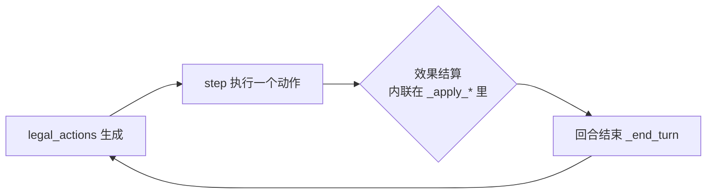
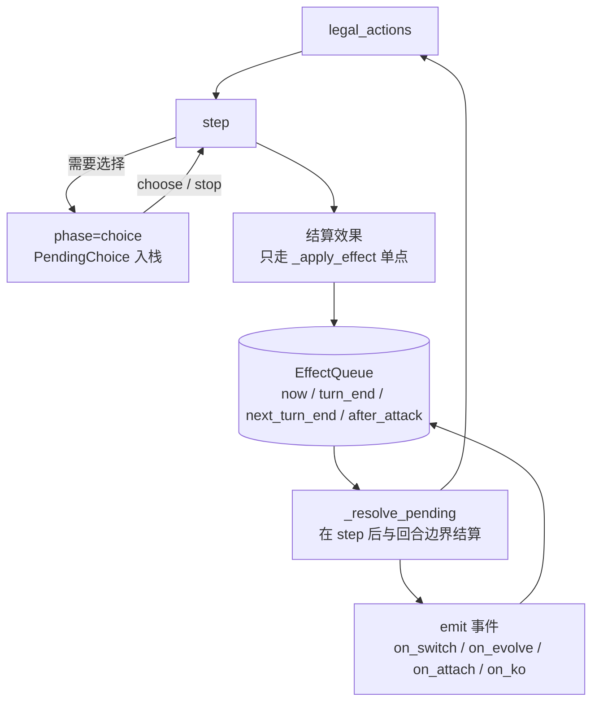
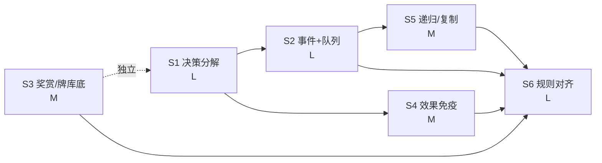

# 引擎「完整规则」改造方案（v2.0 路线）

> 目标：把引擎从「简化可对战子集」推进到**规则完整的对战引擎**，并让剩余 78 张卡
> 不再是「做不了」而是「按规则可做」。
>
> 本文件是**方案**，不是实施记录。批准后按 §9 的「第一刀」开工；每阶段落地后回填
> `docs/RULES_RUNBOOK_B90_PLUS.md` 与 `docs/RULE_CONFORMANCE.md`。
>
> 现状基线（2026-11-08 实测）：`engine_ready` **1189/1267 = 93.8%**，池 **1174**，
> 未 ready **78**（批内如实拒收 72 + 结构性 4 + 待新能力 2），测试 2500，CI 8/8。

---

## 0. 分析摘要（结论先行）

**剩余 78 张卡做不完，根因不是「卡面太怪」，而是引擎缺三个结构件。** 五类缺口只是
这三个结构件的**症状**：

| 缺失结构件 | 直接造成的缺口 | 受影响卡（实测，见 §1） |
|---|---|---|
| **决策分解层**（把「选什么」变成动作空间里的合法动作） | 任意数量 / 可选代价 / 多目标分配 / 二选一 | **18** 张 |
| **事件总线 + 延迟队列**（把「什么时候发生」变成一等公民） | 换位/进化/附能触发 12 + 回合末/下回合末 3 | **15** 张 |
| **区域对象化**（奖赏卡、牌库底、对手手牌/牌库都变成可寻址对象） | 奖赏卡对象、牌库底读写、对手区域操作 | **8** 张 |
| （应用层 1）**效果免疫单点** | 「防止对手卡牌效果」「失去特性」 | **7** 张 |
| （应用层 2）**递归效果/复制招式** | coin 嵌套、复制对手招式 | **3** 张 |

另有 **27** 张不进这五个结构件，但要一起做完才算「完整」：
静态修正补完 9（双属性 / 队伍级 +HP / 能量供给改写 / 道具上限 2 / 阵营减费）·
计数源 3（弃顶 N 张按类别计数）· 退化 devolve 3 · 规则例外 12（先手首回合、setup 放置、
进化改写、KO 替换、道具授予招式、回手封锁、弃战斗位不取奖赏）。

**关键判断：继续用「确定性默认」消缺口是造假。** 正确做法是把选择搬进动作空间，
让策略去选 —— 这正是 TCG 引擎的标准做法（决策分解 / sub-decision protocol），也能
一次性解决历史上被反复拒收的 96 / 103 批同源问题。

**同时必须承认：完整规则 ≠ 只做五类缺口。** 现有 `GameConfig` 里还留着 4 个简化
开关（先手首回合可攻击、首回合抽牌、手牌上限 30、奖赏卡不实际发牌），这些不关掉，
「完整规则」就是空话。方案把它们归到 S6，并配一致性矩阵验收。

---

## 1. 证据：78 张未 ready 卡的机制分布（逐卡归类）

按**卡面需要的新能力**归类（一张卡可能跨多类，取主因）：

**单标签归因，合计 78**（脚本按卡名精确匹配、逐张人工定主因，可复算）：

| 机制族 | 张数 | 卡 |
|---|---|---|
| 交互层：任意数量 / 可选代价 / 多目标分配 / 二选一 | **18** | Mega Charizard X ex · Alakazam · Alolan Exeggutor ex · Dialga · Doublade · Forretress · Gorebyss · Kieran · Lillie's Ribombee · Naveen · Shiftry · Sinistcha · Smeargle · TR Honchkrow · Walking Wake · Wellspring Mask Ogerpon ex · Zarude · Mega Eelektross ex |
| 事件触发：换位 / 进化 / 附能 / 击倒 | **12** | Amulet of Hope · Archaludon ex · Boomerang Energy · Grumpig · Heavy Baton · Latios · Lycanroc · Mismagius ex · Pachirisu · Palafin · TR Ampharos · TR Dugtrio |
| 区域对象化：奖赏卡 / 牌库底 / 对手手牌与牌库 | **8** | Accompanying Flute · Gumshoos · Mandibuzz · Misty's Psyduck · Redeemable Ticket · TR Blipbug · TR Bother-Bot · TR Persian ex |
| 效果免疫 / 特性封锁 | **7** | TR Articuno · Cetitan ex · Fraxure · Golduck · Iron Thorns ex · Psyduck · Antique Sail Fossil |
| 延迟队列（回合末 / 下回合末） | **3** | Amarys · Powerglass · TR Grimer |
| 复制招式 / coin 嵌套 | **3** | Ethan's Sudowoodo · Lucian · TR Great Ball |
| 静态修正补完 | **9** | Carbink · Hop's Choice Band · Lillie's Clefairy ex · Ludicolo · Meganium · Megaton Blower · Okidogi · Rotom ex · Scovillain ex |
| 计数源（弃顶 N 张按类别计数） | **3** | Dedenne · Mega Abomasnow ex · Misty's Gyarados |
| 退化 devolve | **3** | Archeops · Espeon ex · Strange Timepiece |
| 规则例外 / 单卡机制 | **12** | Anthea & Concordia · Cinderace · Core Memory · Eevee ex · Gengar · Klinklang · Meloetta ex · Milotic · Palafin ex · Revavroom ex · Sylveon ex · TR Moltres ex |

> **口径说明**：一张卡常有多个缺口（如 Sylveon ex 既有选择也有跨回合招式记忆），
> 本表按**主因**单标签归类，故合计恰为 78；台账（`RULES_RUNBOOK_B90_PLUS.md`）
> 按**批次**记录拒收理由，两者互补，不要互相核对数字。

---

## 2. 根因：三个结构件缺失 + 两处「应用层」欠账

### 2.1 现在的单回合流程是线性的



问题有三处：

1. **没有「等待决策」的状态**：`phase` 永远是 `"main"`，一次 `step` 必须把效果
   全部做完。于是「任意数量」只能二选一：要么引擎替玩家挑（造假），要么整卡拒收。
2. **没有「事件」概念**：`_log(...)` 只是日志，没有任何钩子。卡面「whenever your
   opponent's Active moves to the Bench」在引擎里**无处挂载**。
3. **没有「时间」维度**：只有「立刻」和「到期回合数」两种粗糙语义；
   「at the end of your opponent's next turn」这类**延迟到未来某时点**的动作没有容器。

### 2.2 目标流程：决策与效果解耦，事件与队列贯通



---

## 3. 目标架构：五个构件的确切接口

### 3.1 决策分解层（`engine/choice.py`）

```python
@dataclass
class PendingChoice:
    kind: str          # discard_energy / attach / pick_target / prize / order / copy_attack …
    source: str        # 产生它的 tag（回溯用）
    owner: int         # 谁来做这个选择
    options: list      # 合法选项（每项可序列化，进回放）
    picked: list       # 已选
    min: int = 0
    max: int = 0       # -1 = 不限
    then: str = ""     # 选完接着执行的 tag（可空）
    expire: str = ""   # 守卫：必须在哪个时点前闭合
```

- `Battle.phase ∈ {"main", "choice", "over"}`
- `legal_actions()` 在 `choice` 阶段返回 `[{"verb": "choose", "pick": i, …}]`
  + `{"verb": "stop"}`（仅当 `len(picked) >= min`）
- `step()` 在 `choice` 阶段只接受 `choose` / `stop`，**其他动作抛 ValueError**
- **冻结守卫**：`phase == "choice"` 时任何状态字段不得变化（用状态指纹断言）
- 选项集由**每个 tag 自己的 builder** 给出（多项式、卡面语义驱动），不做通用子集枚举

**为什么这不是「确定性默认」**：引擎从不替玩家挑。每一步都是动作空间里的一次
真实选择，回放里含完整选择序列，策略可以学。§4 给出复杂度账。

### 3.2 事件总线 + 延迟队列（`engine/events.py`）

```python
EMIT_POINTS = ("turn_begin", "turn_end", "attack_done", "checkup",
               "switch_out", "switch_in", "evolve", "attach_energy",
               "play_trainer", "damage", "ko")

@dataclass
class QueuedEffect:
    owner: int
    when: str        # "now" | "turn_end:0" | "next_turn_end:1" | "after_attack" | "checkup"
    tag: str
    ctx: dict
    expire_turn: int # 守卫：过期未结算 → 抛错（禁止"卡在队列里永不执行"）
```

- 订阅者：特性 `on_event:<kind>:<tag>`、道具 `tool:on_event:<kind>:<tag>`、
  场地 `stadium:on_event:`、特殊能量
- 结算点固定且唯一：`step()` 末尾、`_end_turn()` 前后、`_resolve_ko()` 之后
- 顺序：同一时点的多条按（所属玩家序 → 卡片入场序 → 插入序）FIFO，全部写日志；
  若卡面允许玩家排序，则**转成 choice**（`kind="order"`），不默认
- 反面教材守卫：队列非空却推进回合 → 测试变红

### 3.3 区域对象化（`state.py`）

| 现状 | 目标 |
|---|---|
| `prizes_left: int`（**奖赏卡没真的从牌库取出**，牌库还是满的） | `prizes: list[PrizeSlot{ref, face_up}]`，`prizes_left` 降级为 property（38 处调用零改动） |
| 牌库底只能读（`recon_bottom`） | `deck_bottom_put(ref)` / `deck_bottom_take(n)` / `put_on_top` 三个原子操作 |
| 对手牌库不可寻址 | `peek(pi, zone, n)` + choice 协议（Tr Persian ex 等） |

⚠ **前置事实**：现在奖赏卡是「凭空计数」，`_setup_openings()` 只放战斗位与后备，
没有从牌库取 6 张。对象化后牌库会少 6 张 → `deck_count` 观测、牌库耗尽判定、
现有 2500 条测试里所有「牌库 20 张」的夹具都会受影响。必须**同一阶段**改完并同步
encoder 口径（`deck_count/60` → `/47`），否则观测量会静默漂移。

### 3.4 效果免疫单点（`battle._apply_effect`）

现状：状态/指示物/回复/弃能/回手各自内联改 `fp`，免疫只能逐处加判断（已加过 4 处，
继续加必漏）。目标：**所有「对某只宝可梦施加的效果」只走一个函数**：

```python
def _apply_effect(self, kind, source, target, tag, ctx):
    if self._effects_immune(target, source, kind):   # 单点判定
        self._log("effect_immune", {...})
        return False
    return self._apply_effect_impl(...)
```

免疫来源词表：`attack` / `basic_attack` / `item` / `supporter` / `ability` / `stadium`。
守卫：`grep` 级断言 + 测试注入（在 `_apply_effect_impl` 之外直接改 `fp.damage`
的写法必须被测试抓到）。

### 3.5 递归效果 + 复制招式（`effects.py` + `battle`）

- `coin:heads:<tag>` 里的 `<tag>` 允许是任意合法 tag（含 `a|b`）→ 递归调用，
  **深度上限 2**，超出即抛错（防自我复制）
- `borrow_attack:<scope>` 在**结算时**取源招式（damage/effects/cost），
  目标由 choice 协议产生（对手牌库顶 10 张选 1 招、对手战斗位选 1 招）
- 守卫：复制来的招式**不得**再次 `borrow_attack`（递归截断）

---

## 4. 关键设计决策：为什么是「决策分解」而不是更聪明的默认

| 方案 | 做法 | 结果 |
|---|---|---|
| A 确定性默认 | 引擎按启发式挑（如「总是弃满」） | **已被否**：实质改变对局结果，且对局里看不出来 = 造假 |
| B 全子集枚举 | 一次动作带完整选择集合 | 手牌 10 张弃任意张 = 2^10 选项；能量 8 个 = 2^8；动作空间爆炸且不可扩展 |
| **C 决策分解（推荐）** | 每步选 1 个 + `stop` | 步数 = k+1，每步选项 ≤ 当前候选数；回放可审计；策略可学 |

复杂度对照（Inferno X「弃任意数量火能量」为例）：

| 方案 | 单次决策空间 | 决策步数 |
|---|---|---|
| B | 2^8 = 256 | 1 |
| C | ≤ 8（还能更小：按属性聚合） | k+1（k ≤ 8） |

**收益外溢**：S1 一旦到位，以下历史拒收全部变成「可以按规则做」——
96 批（任意数量弃牌）、103 批（可选能量代价）、任意数量附着、多目标伤害分配、
奖赏卡选择、复制招式选择、同时触发的排序选择。

---

## 5. 分阶段实施（S1–S6）

每阶段的 DoD 统一为：目标卡进池（逐卡打印核对）· 对账全绿 · 三包+card-db 测试全绿 ·
注入式负向自测确认变红 · `ci_local.py` 8/8 · 台账与 README 数字自洽。

### S1 · 决策分解层（L · 解锁 ~18 张）

| 项 | 内容 |
|---|---|
| 新增 | `engine/choice.py`（`PendingChoice` + 每 tag 的 `build_options`） |
| 改动 | `battle.legal_actions`（choice 分支）、`battle.step`（choice 门禁）、`battle.phase`、日志/回放格式（`choice_*` 事件） |
| tag | 新族 `choose:<kind>`（内部用）；既有 `dmg_set:N:per:own_discarded_this_turn` 等改为「先选择、后结算」 |
| 守卫 | ① choice 未决时状态指纹不变；② `stop` 在 `min` 未满足时非法；③ 注入「引擎自选」写法必须变红 |
| 卡 | Inferno X · Alakazam · Dialga · Alolan Exeggutor ex · Honchkrow · Doublade · Naveen · Kieran · Walking Wake … |
| 风险 | agent 动作编码需 +2 维（`n`、`pay`）→ action_dim 变化 → **必须重训**（见 §7.3） |

### S2 · 事件总线 + 延迟队列（L · 解锁 12 + 3 = 15 张）

| 项 | 内容 |
|---|---|
| 新增 | `engine/events.py`（`emit` / `EffectQueue` / 订阅解析） |
| 改动 | `_begin_turn` / `_end_turn` / `_resolve_ko` / `step` 末尾插入**唯一**结算点；`_take_off_field`（换位）、`evolve`（进化）、`attach`（附能）处 `emit` |
| tag | `on_event:<kind>:<tag>`（特性/道具/场地/特殊能量四类载体）· `queue:<when>:<tag>` |
| 守卫 | ① 回合结束时队列必须清空（或显式结转并日志）；② `expire_turn` 过期未结算 → 抛错；③ 同时触发顺序必须可复现（同 seed 同序列） |
| 卡 | Swirling Prose · Holes · Darkest Impulse · Pachirisu · Latios · Amarys · Corrosive Sludge · Powerglass · Heavy Baton · Amulet of Hope |
| 风险 | 触发链可能无限（A 触发 B 触发 A）→ 加「每回合每订阅最多触发次数」并在日志里显式标注 |

### S3 · 奖赏卡与牌库底对象化（M · 解锁 8 张）

| 项 | 内容 |
|---|---|
| 新增 | `PrizeSlot`；`deck_bottom_put/take`；`peek(pi, zone, n)` |
| 改动 | `_setup_openings`（真发 6 张奖赏）· `_resolve_ko`（取奖赏走 choice）· `recon_bottom` 复用新原语 · encoder 的 `deck_count` 口径 |
| tag | `prize:<op>`（peek / flip_face_up / shuffle_to_deck / redeal）· `deck_bottom:<op>` |
| 守卫 | ① 牌库+手牌+奖赏+弃牌+场上 = 60 恒等式；② 牌库耗尽判负（官方规则，现在没有） |
| 卡 | Redeemable Ticket · Bother-Bot · Blipbug · Misty's Psyduck · Gumshoos · TR Persian ex · Accompanying Flute |
| 风险 | 改变牌库张数 → 现有夹具与观测特征全部受影响；**建议单独一个 PR，不与 S1 混提交** |

### S4 · 效果免疫单点（M · 解锁 ~7 张）

| 项 | 内容 |
|---|---|
| 改动 | 抽出 `_apply_effect(kind, source, target, tag, ctx)`；把 `_apply_counters` / `_apply_heal` / `snipe` / `bounce` / `discard_energy` / 状态施加 / `pre` 全部改走单点 |
| tag | `passive:effects_immune:<source>[:scope]` · `passive:attack_effects_immune:basic` 等 |
| 守卫 | 「绕过单点」的写法必须被测试抓到（注入式） |
| 卡 | Repelling Veil · Snow Camouflage · Unnerve · Protective Sail |
| 风险 | 重构面最大的一段（涉及每个效果入口）→ 必须先补「入口清单」再动，改一处跑一次全量 |

### S5 · 递归效果 + 复制招式（M · 解锁 3 张）

| 项 | 内容 |
|---|---|
| 改动 | `_apply_attack_effects` 支持 `coin:heads:<任意 tag>` 递归（深度 ≤2）；`borrow_attack` 结算时复制 |
| tag | `borrow_attack:opp_deck_top:<n>` · `borrow_attack:opp_active` + `coin:` 嵌套 |
| 守卫 | 递归深度、复制来的招式不得再复制、循环检测 |
| 卡 | Ethan's Sudowoodo · TR Great Ball · Lucian · TR Persian ex · Haughty Order |

### S6 · 官方规则对齐（L · 无新卡，但决定「完整」与否）

| 简化开关（`state.py::GameConfig`） | 现状 | 官方规则 | 影响 |
|---|---|---|---|
| `first_turn_no_attack` | **False**（先手首回合可攻击） | 先手第一回合**不能**攻击 | 改变开局胜率与 K1 基线；Meloetta ex「Debut Performance」正是**例外**卡，改完才有意义 |
| `first_turn_no_draw` | **False**（每回合都抽 1） | 先手第一回合**不抽牌** | 同上 |
| `max_hand` | 30（超了弃牌，简易保护） | 无手牌上限 | 移除后需防死循环 |
| `mulligan_compensation` | 重抽直到有基础宝可梦（隐式） | 玩家**可选**重抽，对手补抽 1 | 需 choice 协议（S1） |
| 奖赏卡 | **不实际发牌**（只计数） | 开局从牌库取 6 张，面朝下 | S3 |

除开关外，完整规则还要求（逐条进一致性矩阵）：

1. **特殊状态全套**：睡眠/麻痹/混乱/灼伤/中毒互斥与替换顺序；进化解除状态；
   检查期结算顺序（中毒→灼伤→睡眠判定）
2. **伤害计算流水线**：基础 → ±N（弱点前）→ ×弱点 → −抗性 → 护盾/免疫 → 指示物；
   目前顺序散落在多处，需收敛为一条函数
3. **KO 与奖赏时机**：多只同时被击倒、奖赏不足时取剩余、KO 替换层（Gengar）
4. **进化时机**：当回合不能进化刚上场/刚进化的、Rare Candy 跳阶、进化改写（Rainbow DNA）
5. **撤退与换位**：撤退费弃能顺序、状态解除、换入者、回手封锁（Milotic）
6. **道具/场地上限**：单只 1 张（Rotom ex 可 2）、场地唯一、ACE SPEC 一副一张
7. **牌库耗尽判负**、起手无基础宝可梦的 mulligan 补偿
8. **信息规则**：面朝下奖赏卡不得被读取（`info:reveal_hand` 的等价前提要写清楚：
   引擎完美信息，但**奖赏卡面朝下**是真实隐藏信息，S3 落地后必须区分）

---

## 6. 验收体系（防「改完更假」）

### 6.1 三条硬守卫（每阶段都必须有）

1. **无默认守卫**：`phase=="choice"` 时状态指纹（全字段哈希）必须与进入时一致；
   注入「引擎替玩家选」的实现 → 测试变红
2. **队列不泄漏**：`_end_turn` 结束时队列为空，或结转项有显式日志与 `expire_turn`
3. **单点守卫**：效果施加路径唯一（AST 扫描 `_apply_effect_impl` 之外对
   `fp.damage / fp.status` 的写入）

### 6.2 规则一致性矩阵 `docs/RULE_CONFORMANCE.md`

一行一条规则：`规则 | 实现点(文件::函数) | 测试名 | 覆盖卡数 | 状态`。
只有矩阵 100% 才算「完整规则」，README 里不再出现「简化子集」字样。

### 6.3 重训与评估（S1 必做）

`state_encoder.encode_action` 当前 14 维（basic）/ +17（rich），新增 `n`、`pay`
两维 → `action_dim` 变化 → **权重不兼容**（README 已声明绑定）。
流程：BC 重训 → PPO → **双盲 200 局 ≥ 0.795** 才接受（否则视为回归，先查编码而不是降指标）。

### 6.4 性能

决策分解会增加每局决策步数（每步一次前向）。对策：合法动作批量推理 +
`stop` 早停 + choice 阶段复用上一步的 state 编码（只更新 pending 特征）。

---

## 7. 顺序、依赖与工作量



| 阶段 | 体量 | 依赖 | 解锁卡 | 风险 |
|---|---|---|---|---|
| S1 决策分解 | L | — | 18 | 中（agent 重训） |
| S2 事件+队列 | L | S1（排序选择） | 15 | 中高（触发链） |
| S3 奖赏/牌库底 | M | 独立 | 8 | 中（改变牌库口径） |
| S4 效果免疫 | M | S1 | 7 | 高（重构面最大） |
| S5 递归/复制 | M | S1+S2 | 3 | 低 |
| S6 规则对齐 | L | S2+S3+S4+S5 | 例外卡 12 + 全局正确性 | 中高（K1 基线会变） |

**推荐顺序：S1 → S3 → S2 → S4 → S5 → S6。**
理由：S1 解锁最多且是 S4/S5 的前提；S3 独立且改动集中（可并行开一个分支）；
S6 放最后，因为它会改 K1 基线与观测量，必须等其它结构件稳定。

---

## 8. 第一刀（S1a）的确切范围

只做**骨架 + 一张卡端到端**，把协议跑通再铺开：

**改动**
1. `packages/engine/engine/choice.py`：`PendingChoice` + `build_options(tag, ctx)`
2. `battle.py`：`phase` 三态、`legal_actions` 的 choice 分支、`step` 的 choice 门禁、
   状态指纹守卫、`choice_*` 日志事件
3. `effects.py`：`dmg_set:N:per:own_discarded_this_turn` 改为产出 `choose:discard_energy:…`
4. `state_encoder.py`：`encode_action` +2 维（`n`=选了几个、`pay`=是否付可选代价），
   `EncoderConfig` 版本号 +1；`action_dim` 变化 → 旧权重加载时**明确报错并提示重训**
5. `apps/api`：回放序列化新增 `choice` 事件（旧回放无该字段 → 视为 main，保持兼容）

**验证**
- 引擎：Inferno X 选项集正确、`stop` 边界、未决时状态冻结、注入守卫变红
- agent：编码维度/旧权重不兼容守卫（不是静默降级）
- 回放：同 seed + 同选择序列 → 逐事件一致
- 全量 2500 测试保持全绿；`ci_local.py` 8/8

**明确不做**：事件总线、奖赏对象、免疫层（留给 S2–S4，避免一次改太多导致定位困难）。

---

## 9. 风险与回滚

| 风险 | 表现 | 对策 |
|---|---|---|
| action_dim / state_dim 漂移 | 旧权重静默降级或维度错 | 权重里存 `encoder_version`，不匹配就**拒绝加载**并提示重训 |
| 决策步数变多 → 训练变慢 | 3000 局耗时上升 | 批量推理 + `stop` 早停 + choice 复用编码 |
| 事件触发链无限 | 对局卡死 | 每订阅每回合触发上限 + `expire_turn` 抛错 |
| S3 改变牌库口径 | 大量夹具失败、观测漂移 | 单独 PR + 一次性改齐夹具 + encoder 口径同步 |
| 存量测试是承重墙 | 改一处红一片 | 每阶段先跑 `test_*_rejected` 清单（历史改判点都在里面） |

**回滚**：每阶段独立分支 + 独立开关（`GameConfig.use_choice_protocol` 之类），
开关关闭时行为与今天**逐字节一致**（用回放对拍验证），保证随时可退回。

---

## 10. 确认清单（逐项回复即可）

| # | 决策 | 选项 | 我的建议 |
|---|---|---|---|
| A | 范围 | ① 只做五类缺口（~60 张，S1–S5）② 连 S6 一起做成「完整规则」 | **②**（否则「完整规则」名不副实） |
| B | 决策分解粒度 | ① 所有效果都走 choice 协议（统一但改动大）② 仅「多选择」效果走协议 | **①**（统一才能保证无默认；② 会留下两套语义） |
| C | K1 重训 | ① 允许重训并接受基线重测 ② 冻结旧权重不重训 | **①**（action_dim 必变，冻结等于放弃 S1） |
| D | 开工顺序 | ① S1 → S3 → S2 → S4 → S5 → S6（本方案）② 先 S3（低风险快收益） | **①**（S1 是其余前提） |
| E | 确认门槛 | ① 逐阶段确认（每个 S 完成后我停下汇报）② 一次批准到 S6 | **①**（S4 重构面最大，中途需要校验点） |

回复「开始撰写」= 按 A② B① C① D① E① 执行；
或回复「A1 B2 …」逐项改；或回复「先做 S1a」= 只做一个 PR 的骨架。

---

## 附：与现有文档的关系

| 文档 | 角色 |
|---|---|
| `docs/RULES_RUNBOOK_B90_PLUS.md` | **批次台账**（90–134 批的逐批进池/拒收记录）—— 本方案落地后，拒收项要逐条**回流**到新批次 |
| `docs/RULE_CONFORMANCE.md`（待建） | **规则矩阵**（完整规则的判据） |
| `.workbuddy/memory/REFERENCE_rules_modeling.md` | 建模纪律 24 条 —— S1–S6 全部继续适用（尤其「负向自测必须真能变红」） |
| `README.md` | 对外承诺：S6 完成后删除「简化子集」表述 |
