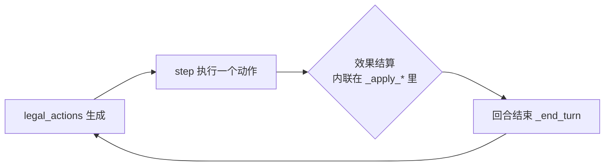
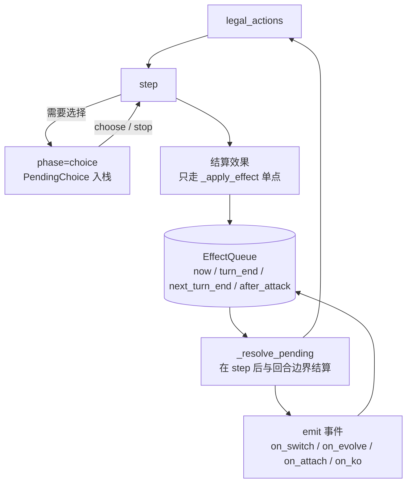
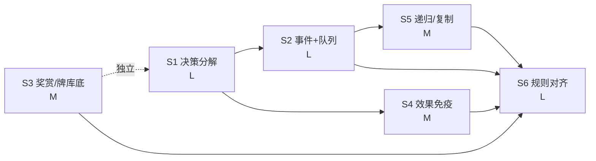

# 引擎「完整规则」改造方案（v2.0 路线）

> 目标：把引擎从「简化可对战子集」推进到**规则完整的对战引擎**，并让剩余 78 张卡
> 不再是「做不了」而是「按规则可做」。
>
> 本文件是**方案**，不是实施记录。批准后按 §9 的「第一刀」开工；每阶段落地后回填
> `docs/RULES_RUNBOOK_B90_PLUS.md` 与 `docs/RULE_CONFORMANCE.md`。
>
> 现状基线（2026-11-08 实测）：`engine_ready` **1222/1267 = 96.4%**，池 **1207**，
> 未 ready **45**（批内如实拒收 41 + 结构性 4），测试 **2718**，CI 8/8。
> 进度：**S1 全 / S2 全 / S3 / S4 已落地**（见 §10 的落地记录与偏差登记）。

---

## 0. 分析摘要（结论先行）

**剩余 78 张卡做不完，根因不是「卡面太怪」，而是引擎缺三个结构件。** 五类缺口只是
这三个结构件的**症状**：

| 缺失结构件 | 直接造成的缺口 | 受影响卡（实测，见 §1） |
|---|---|---|
| **决策分解层**（把「选什么」变成动作空间里的合法动作） | 任意数量 / 可选代价 / 多目标分配 / 二选一 | **18** 张 |
| **事件总线 + 延迟队列**（把「什么时候发生」变成一等公民） | 换位/进化/附能触发 12 + 回合末/下回合末 3 | **15** 张 |
| **区域对象化**（奖赏卡、牌库底、对手手牌/牌库都变成可寻址对象） | 奖赏卡对象、牌库底读写、对手区域操作 | **8** 张 |
| （应用层 1）**效果免疫单点** | 「防止对手卡牌效果」「失去特性」 | **7** 张 |
| （应用层 2）**递归效果/复制招式** | coin 嵌套、复制对手招式 | **3** 张 |

另有 **27** 张不进这五个结构件，但要一起做完才算「完整」：
静态修正补完 9（双属性 / 队伍级 +HP / 能量供给改写 / 道具上限 2 / 阵营减费）·
计数源 3（弃顶 N 张按类别计数）· 退化 devolve 3 · 规则例外 12（先手首回合、setup 放置、
进化改写、KO 替换、道具授予招式、回手封锁、弃战斗位不取奖赏）。

**关键判断：继续用「确定性默认」消缺口是造假。** 正确做法是把选择搬进动作空间，
让策略去选 —— 这正是 TCG 引擎的标准做法（决策分解 / sub-decision protocol），也能
一次性解决历史上被反复拒收的 96 / 103 批同源问题。

**同时必须承认：完整规则 ≠ 只做五类缺口。** 现有 `GameConfig` 里还留着 4 个简化
开关（先手首回合可攻击、首回合抽牌、手牌上限 30、奖赏卡不实际发牌），这些不关掉，
「完整规则」就是空话。方案把它们归到 S6，并配一致性矩阵验收。

---

## 1. 证据：78 张未 ready 卡的机制分布（逐卡归类）

按**卡面需要的新能力**归类（一张卡可能跨多类，取主因）：

**单标签归因，合计 78**（脚本按卡名精确匹配、逐张人工定主因，可复算）：

| 机制族 | 张数 | 卡 |
|---|---|---|
| 交互层：任意数量 / 可选代价 / 多目标分配 / 二选一 | **18** | Mega Charizard X ex · Alakazam · Alolan Exeggutor ex · Dialga · Doublade · Forretress · Gorebyss · Kieran · Lillie's Ribombee · Naveen · Shiftry · Sinistcha · Smeargle · TR Honchkrow · Walking Wake · Wellspring Mask Ogerpon ex · Zarude · Mega Eelektross ex |
| 事件触发：换位 / 进化 / 附能 / 击倒 | **12** | Amulet of Hope · Archaludon ex · Boomerang Energy · Grumpig · Heavy Baton · Latios · Lycanroc · Mismagius ex · Pachirisu · Palafin · TR Ampharos · TR Dugtrio |
| 区域对象化：奖赏卡 / 牌库底 / 对手手牌与牌库 | **8** | Accompanying Flute · Gumshoos · Mandibuzz · Misty's Psyduck · Redeemable Ticket · TR Blipbug · TR Bother-Bot · TR Persian ex |
| 效果免疫 / 特性封锁 | **7** | TR Articuno · Cetitan ex · Fraxure · Golduck · Iron Thorns ex · Psyduck · Antique Sail Fossil |
| 延迟队列（回合末 / 下回合末） | **3** | Amarys · Powerglass · TR Grimer |
| 复制招式 / coin 嵌套 | **3** | Ethan's Sudowoodo · Lucian · TR Great Ball |
| 静态修正补完 | **9** | Carbink · Hop's Choice Band · Lillie's Clefairy ex · Ludicolo · Meganium · Megaton Blower · Okidogi · Rotom ex · Scovillain ex |
| 计数源（弃顶 N 张按类别计数） | **3** | Dedenne · Mega Abomasnow ex · Misty's Gyarados |
| 退化 devolve | **3** | Archeops · Espeon ex · Strange Timepiece |
| 规则例外 / 单卡机制 | **12** | Anthea & Concordia · Cinderace · Core Memory · Eevee ex · Gengar · Klinklang · Meloetta ex · Milotic · Palafin ex · Revavroom ex · Sylveon ex · TR Moltres ex |

> **口径说明**：一张卡常有多个缺口（如 Sylveon ex 既有选择也有跨回合招式记忆），
> 本表按**主因**单标签归类，故合计恰为 78；台账（`RULES_RUNBOOK_B90_PLUS.md`）
> 按**批次**记录拒收理由，两者互补，不要互相核对数字。

---

## 2. 根因：三个结构件缺失 + 两处「应用层」欠账

### 2.1 现在的单回合流程是线性的



问题有三处：

1. **没有「等待决策」的状态**：`phase` 永远是 `"main"`，一次 `step` 必须把效果
   全部做完。于是「任意数量」只能二选一：要么引擎替玩家挑（造假），要么整卡拒收。
2. **没有「事件」概念**：`_log(...)` 只是日志，没有任何钩子。卡面「whenever your
   opponent's Active moves to the Bench」在引擎里**无处挂载**。
3. **没有「时间」维度**：只有「立刻」和「到期回合数」两种粗糙语义；
   「at the end of your opponent's next turn」这类**延迟到未来某时点**的动作没有容器。

### 2.2 目标流程：决策与效果解耦，事件与队列贯通



---

## 3. 目标架构：五个构件的确切接口

### 3.1 决策分解层（`engine/choice.py`）

```python
@dataclass
class PendingChoice:
    kind: str          # discard_energy / attach / pick_target / prize / order / copy_attack …
    source: str        # 产生它的 tag（回溯用）
    owner: int         # 谁来做这个选择
    options: list      # 合法选项（每项可序列化，进回放）
    picked: list       # 已选
    min: int = 0
    max: int = 0       # -1 = 不限
    then: str = ""     # 选完接着执行的 tag（可空）
    expire: str = ""   # 守卫：必须在哪个时点前闭合
```

- `Battle.phase ∈ {"main", "choice", "over"}`
- `legal_actions()` 在 `choice` 阶段返回 `[{"verb": "choose", "pick": i, …}]`
  + `{"verb": "stop"}`（仅当 `len(picked) >= min`）
- `step()` 在 `choice` 阶段只接受 `choose` / `stop`，**其他动作抛 ValueError**
- **冻结守卫**：`phase == "choice"` 时任何状态字段不得变化（用状态指纹断言）
- 选项集由**每个 tag 自己的 builder** 给出（多项式、卡面语义驱动），不做通用子集枚举

**为什么这不是「确定性默认」**：引擎从不替玩家挑。每一步都是动作空间里的一次
真实选择，回放里含完整选择序列，策略可以学。§4 给出复杂度账。

### 3.2 事件总线 + 延迟队列（`engine/events.py`）

```python
EMIT_POINTS = ("turn_begin", "turn_end", "attack_done", "checkup",
               "switch_out", "switch_in", "evolve", "attach_energy",
               "play_trainer", "damage", "ko")

@dataclass
class QueuedEffect:
    owner: int
    when: str        # "now" | "turn_end:0" | "next_turn_end:1" | "after_attack" | "checkup"
    tag: str
    ctx: dict
    expire_turn: int # 守卫：过期未结算 → 抛错（禁止"卡在队列里永不执行"）
```

- 订阅者：特性 `on_event:<kind>:<tag>`、道具 `tool:on_event:<kind>:<tag>`、
  场地 `stadium:on_event:`、特殊能量
- 结算点固定且唯一：`step()` 末尾、`_end_turn()` 前后、`_resolve_ko()` 之后
- 顺序：同一时点的多条按（所属玩家序 → 卡片入场序 → 插入序）FIFO，全部写日志；
  若卡面允许玩家排序，则**转成 choice**（`kind="order"`），不默认
- 反面教材守卫：队列非空却推进回合 → 测试变红

### 3.3 区域对象化（`state.py`）

| 现状 | 目标 |
|---|---|
| `prizes_left: int`（**奖赏卡没真的从牌库取出**，牌库还是满的） | `prizes: list[PrizeSlot{ref, face_up}]`，`prizes_left` 降级为 property（38 处调用零改动） |
| 牌库底只能读（`recon_bottom`） | `deck_bottom_put(ref)` / `deck_bottom_take(n)` / `put_on_top` 三个原子操作 |
| 对手牌库不可寻址 | `peek(pi, zone, n)` + choice 协议（Tr Persian ex 等） |

⚠ **前置事实**：现在奖赏卡是「凭空计数」，`_setup_openings()` 只放战斗位与后备，
没有从牌库取 6 张。对象化后牌库会少 6 张 → `deck_count` 观测、牌库耗尽判定、
现有 2500 条测试里所有「牌库 20 张」的夹具都会受影响。必须**同一阶段**改完并同步
encoder 口径（`deck_count/60` → `/47`），否则观测量会静默漂移。

### 3.4 效果免疫单点（`battle._apply_effect`）

现状：状态/指示物/回复/弃能/回手各自内联改 `fp`，免疫只能逐处加判断（已加过 4 处，
继续加必漏）。目标：**所有「对某只宝可梦施加的效果」只走一个函数**：

```python
def _apply_effect(self, kind, source, target, tag, ctx):
    if self._effects_immune(target, source, kind):   # 单点判定
        self._log("effect_immune", {...})
        return False
    return self._apply_effect_impl(...)
```

免疫来源词表：`attack` / `basic_attack` / `item` / `supporter` / `ability` / `stadium`。
守卫：`grep` 级断言 + 测试注入（在 `_apply_effect_impl` 之外直接改 `fp.damage`
的写法必须被测试抓到）。

### 3.5 递归效果 + 复制招式（`effects.py` + `battle`）

- `coin:heads:<tag>` 里的 `<tag>` 允许是任意合法 tag（含 `a|b`）→ 递归调用，
  **深度上限 2**，超出即抛错（防自我复制）
- `borrow_attack:<scope>` 在**结算时**取源招式（damage/effects/cost），
  目标由 choice 协议产生（对手牌库顶 10 张选 1 招、对手战斗位选 1 招）
- 守卫：复制来的招式**不得**再次 `borrow_attack`（递归截断）

---

## 4. 关键设计决策：为什么是「决策分解」而不是更聪明的默认

| 方案 | 做法 | 结果 |
|---|---|---|
| A 确定性默认 | 引擎按启发式挑（如「总是弃满」） | **已被否**：实质改变对局结果，且对局里看不出来 = 造假 |
| B 全子集枚举 | 一次动作带完整选择集合 | 手牌 10 张弃任意张 = 2^10 选项；能量 8 个 = 2^8；动作空间爆炸且不可扩展 |
| **C 决策分解（推荐）** | 每步选 1 个 + `stop` | 步数 = k+1，每步选项 ≤ 当前候选数；回放可审计；策略可学 |

复杂度对照（Inferno X「弃任意数量火能量」为例）：

| 方案 | 单次决策空间 | 决策步数 |
|---|---|---|
| B | 2^8 = 256 | 1 |
| C | ≤ 8（还能更小：按属性聚合） | k+1（k ≤ 8） |

**收益外溢**：S1 一旦到位，以下历史拒收全部变成「可以按规则做」——
96 批（任意数量弃牌）、103 批（可选能量代价）、任意数量附着、多目标伤害分配、
奖赏卡选择、复制招式选择、同时触发的排序选择。

---

## 5. 分阶段实施（S1–S6）

每阶段的 DoD 统一为：目标卡进池（逐卡打印核对）· 对账全绿 · 三包+card-db 测试全绿 ·
注入式负向自测确认变红 · `ci_local.py` 8/8 · 台账与 README 数字自洽。

### S1 · 决策分解层（L · 解锁 ~18 张）

| 项 | 内容 |
|---|---|
| 新增 | `engine/choice.py`（`PendingChoice` + 每 tag 的 `build_options`） |
| 改动 | `battle.legal_actions`（choice 分支）、`battle.step`（choice 门禁）、`battle.phase`、日志/回放格式（`choice_*` 事件） |
| tag | 新族 `choose:<kind>`（内部用）；既有 `dmg_set:N:per:own_discarded_this_turn` 等改为「先选择、后结算」 |
| 守卫 | ① choice 未决时状态指纹不变；② `stop` 在 `min` 未满足时非法；③ 注入「引擎自选」写法必须变红 |
| 卡 | Inferno X · Alakazam · Dialga · Alolan Exeggutor ex · Honchkrow · Doublade · Naveen · Kieran · Walking Wake … |
| 风险 | agent 动作编码需 +2 维（`n`、`pay`）→ action_dim 变化 → **必须重训**（见 §7.3） |

### S2 · 事件总线 + 延迟队列（L · 解锁 12 + 3 = 15 张）

| 项 | 内容 |
|---|---|
| 新增 | `engine/events.py`（`emit` / `EffectQueue` / 订阅解析） |
| 改动 | `_begin_turn` / `_end_turn` / `_resolve_ko` / `step` 末尾插入**唯一**结算点；`_take_off_field`（换位）、`evolve`（进化）、`attach`（附能）处 `emit` |
| tag | `on_event:<kind>:<tag>`（特性/道具/场地/特殊能量四类载体）· `queue:<when>:<tag>` |
| 守卫 | ① 回合结束时队列必须清空（或显式结转并日志）；② `expire_turn` 过期未结算 → 抛错；③ 同时触发顺序必须可复现（同 seed 同序列） |
| 卡 | Swirling Prose · Holes · Darkest Impulse · Pachirisu · Latios · Amarys · Corrosive Sludge · Powerglass · Heavy Baton · Amulet of Hope |
| 风险 | 触发链可能无限（A 触发 B 触发 A）→ 加「每回合每订阅最多触发次数」并在日志里显式标注 |

### S3 · 奖赏卡与牌库底对象化（M · 解锁 8 张）

| 项 | 内容 |
|---|---|
| 新增 | `PrizeSlot`；`deck_bottom_put/take`；`peek(pi, zone, n)` |
| 改动 | `_setup_openings`（真发 6 张奖赏）· `_resolve_ko`（取奖赏走 choice）· `recon_bottom` 复用新原语 · encoder 的 `deck_count` 口径 |
| tag | `prize:<op>`（peek / flip_face_up / shuffle_to_deck / redeal）· `deck_bottom:<op>` |
| 守卫 | ① 牌库+手牌+奖赏+弃牌+场上 = 60 恒等式；② 牌库耗尽判负（官方规则，现在没有） |
| 卡 | Redeemable Ticket · Bother-Bot · Blipbug · Misty's Psyduck · Gumshoos · TR Persian ex · Accompanying Flute |
| 风险 | 改变牌库张数 → 现有夹具与观测特征全部受影响；**建议单独一个 PR，不与 S1 混提交** |

### S4 · 效果免疫单点（M · 解锁 ~7 张）

| 项 | 内容 |
|---|---|
| 改动 | 抽出 `_apply_effect(kind, source, target, tag, ctx)`；把 `_apply_counters` / `_apply_heal` / `snipe` / `bounce` / `discard_energy` / 状态施加 / `pre` 全部改走单点 |
| tag | `passive:effects_immune:<source>[:scope]` · `passive:attack_effects_immune:basic` 等 |
| 守卫 | 「绕过单点」的写法必须被测试抓到（注入式） |
| 卡 | Repelling Veil · Snow Camouflage · Unnerve · Protective Sail |
| 风险 | 重构面最大的一段（涉及每个效果入口）→ 必须先补「入口清单」再动，改一处跑一次全量 |

### S5 · 递归效果 + 复制招式（M · 实际进池 4 张）

| 项 | 内容 |
|---|---|
| 改动 | `borrow_attack` 结算时复制招式（付**本招式**费用）；两种新来源：**抛币门**（`coin:heads:` 包住借用）与**对手牌库顶 N 张**；训练家侧两种新形态：抛币分岔检索、手牌放牌库底后**逐人**抛币分抽 |
| tag | `coin:heads:borrow_attack:opp_active` · `borrow_attack:opp_deck_top:<n>` · `coin_search:<heads_stage>:<tails_stage>:category:<c>` · `shuffle_both_bottom_coin_draw:<h>:<t>` |
| 守卫 | 抛币门只抛一次；「you may」必须能放弃（否则引擎替玩家决定）；复制来的招式不得再次借用（深度恒 1）；牌库顶只扫 N 张、结算完才洗回 |
| 卡 | Ethan's Sudowoodo（Impound + Try to Imitate）· Team Rocket's Persian ex（Haughty Order）· Team Rocket's Great Ball · Lucian |

### S6 · 官方规则对齐（L · 无新卡，但决定「完整」与否）

| 简化开关（`state.py::GameConfig`） | 现状 | 官方规则（已核对，见 §5.1） | 影响 |
|---|---|---|---|
| `first_turn_no_attack` | **True**（S6a 已按官方打开） | 先手第一回合**不能**攻击（2013 起） | 已改；例外卡靠 `use_any:first_turn`（见 S6a） |
| ~~`first_turn_no_draw`~~ | False（每回合都抽 1） | **官方就是要抽**（先手首回合也抽）—— 该开关是**伪需求**，应删除或恒 False | 无（现默认已符合官方） |
| **先手首回合禁 Supporter** | 无此判定 → **S6a 已加**（`first_turn_no_supporter`） | 先手第一回合**不能打 Supporter**（2020-02 现行规则） | 两处同挡（legals + 派发）；例外卡 2 张（Carmine / TR Proton）靠卡级 `use_any:first_turn` |
| `max_hand` | **0 = 无上限**（S6a 已改；>0 仅供对拍） | **无手牌上限**（官方 Q&A 明确） | 已改：两处（抽牌 / 取奖赏）都判 `>0` 才裁 |
| `mulligan_compensation` | 重抽直到有基础宝可梦（隐式），对手**自动**补抽 | 无基础宝可梦**必须**重抽（非可选）；对手**可**（may）每 mulligan 抽 1 | 需 choice 协议（S1）让对手自己决定抽不抽 |
| 奖赏卡 | **不实际发牌**（只计数） | 开局从牌库取 6 张，面朝下 | S3 |
| 进化时机 | **S6a 已置位**（`__init__` 里 `_begin_turn()` 之后统一置 `just_played`） | setup 上场的宝可梦**当回合也不能进化** | 已改；后手 T2 因 `_begin_turn` 清零而可进化，与实战一致 |

除开关外，完整规则还要求（逐条进一致性矩阵）：

1. **特殊状态全套**：睡眠/麻痹/混乱/灼伤/中毒互斥与替换顺序；进化解除状态；
   检查期结算顺序（中毒→灼伤→睡眠判定）
2. **伤害计算流水线**：基础 → ±N（弱点前）→ ×弱点 → −抗性 → 护盾/免疫 → 指示物；
   目前顺序散落在多处，需收敛为一条函数
3. **KO 与奖赏时机**：多只同时被击倒、奖赏不足时取剩余、KO 替换层（Gengar）
4. **进化时机**：当回合不能进化刚上场/刚进化的、Rare Candy 跳阶、进化改写（Rainbow DNA）
5. **撤退与换位**：撤退费弃能顺序、状态解除、换入者、回手封锁（Milotic）
6. **道具/场地上限**：单只 1 张（Rotom ex 可 2）、场地唯一、ACE SPEC 一副一张
7. **牌库耗尽判负**、起手无基础宝可梦的 mulligan 补偿
8. **信息规则**：面朝下奖赏卡不得被读取（`info:reveal_hand` 的等价前提要写清楚：
   引擎完美信息，但**奖赏卡面朝下**是真实隐藏信息，S3 落地后必须区分）

---

### 5.1 规则事实核对表（含出处，2026-11-08 核对）

> 本节存在的理由：S6 的每一条都必须是**官方规则**，不能凭记忆。核对过程发现
> 方案初稿有 1 处判断错误（首回合抽牌）与 2 处遗漏（禁支援者、setup 进化），已改。

| # | 规则 | 结论 | 出处 |
|---|---|---|---|
| 1 | 先手第一回合能否攻击 | **不能** | Battle Academy 2024 Rules Reference「First Turn」；Bulbapedia：2013 起先手 T1 不能攻击 |
| 2 | 先手第一回合能否打 Supporter | **不能**（其它 Trainer 可以） | 同上（2020-02 现行：先手抽牌，但 T1 不能用 Supporter、不能攻击） |
| 3 | 先手第一回合是否抽牌 | **抽**（每回合都抽，含先手 T1） | 官方 Q&A（asia.pokemon-card.com）：「Does the player going first draw a card at the start of their first turn? **Yes, always draw a card at the beginning of your turn.**」→ **初稿写反了，已改** |
| 4 | 手牌上限 | **无上限** | 官方 Q&A：「No, there is no limit to how many cards a player can have in their hand.」 |
| 5 | mulligan | 无基础宝可梦 → **必须**洗回重抽；对手**可**（may）每 mulligan 抽 1 | Battle Academy 2024「Mulligan」 |
| 6 | setup 上场的宝可梦能否当回合进化 | **不能** | Battle Academy 2024：「Neither player can evolve any of the Pokémon that they played during setup」 |
| 7 | 奖赏卡 | 开局从牌库顶取 **6** 张面朝下；ex 被击倒取 2、Mega ex 取 3 | Setup 第 7 步；本数据集规则栏 |
| 8 | 后备上限 / 弱点 / 抗性 | 后备 5；弱点 ×2；抗性 −30（历史约定，DP 起以卡面为准） | 规则书 + 卡面 |
| 9 | 牌库抽空 | 回合开始该抽而抽不到 → **判负** | 官方 Q&A / 规则书 |
| 10 | 检查期顺序 | 攻击结束 → Pokémon Checkup（中毒/灼伤结算、KO、回合末效果）→ 换手 | 规则书「Pokémon Checkup」 |

**注意**：第 3 条说明「引擎现状已经符合官方」，S6 里不需要动它 —— 方案初稿把它列成
「要改的简化」，那是错的；真正缺的是第 2 条（禁支援者）与第 6 条（setup 进化）。

## 6. 验收体系（防「改完更假」）

### 6.1 三条硬守卫（每阶段都必须有）

1. **无默认守卫**：`phase=="choice"` 时状态指纹（全字段哈希）必须与进入时一致；
   注入「引擎替玩家选」的实现 → 测试变红
2. **队列不泄漏**：`_end_turn` 结束时队列为空，或结转项有显式日志与 `expire_turn`
3. **单点守卫**：效果施加路径唯一（AST 扫描 `_apply_effect_impl` 之外对
   `fp.damage / fp.status` 的写入）

### 6.2 规则一致性矩阵 `docs/RULE_CONFORMANCE.md`

一行一条规则：`规则 | 实现点(文件::函数) | 测试名 | 覆盖卡数 | 状态`。
只有矩阵 100% 才算「完整规则」，README 里不再出现「简化子集」字样。

### 6.3 重训与评估（S1 必做）

`state_encoder.encode_action` 当前 14 维（basic）/ +17（rich），新增 `n`、`pay`
两维 → `action_dim` 变化 → **权重不兼容**（README 已声明绑定）。
流程：BC 重训 → PPO → **双盲 200 局 ≥ 0.795** 才接受（否则视为回归，先查编码而不是降指标）。

### 6.4 性能

决策分解会增加每局决策步数（每步一次前向）。对策：合法动作批量推理 +
`stop` 早停 + choice 阶段复用上一步的 state 编码（只更新 pending 特征）。

---

## 7. 顺序、依赖与工作量



| 阶段 | 体量 | 依赖 | 解锁卡 | 风险 |
|---|---|---|---|---|
| S1 决策分解 | L | — | 18 | 中（agent 重训） |
| S2 事件+队列 | L | S1（排序选择） | 15 | 中高（触发链） |
| S3 奖赏/牌库底 | M | 独立 | 8 | 中（改变牌库口径） |
| S4 效果免疫 | M | S1 | 7 | 高（重构面最大） |
| S5 递归/复制 | M | S1+S2 | 3 | 低 |
| S6 规则对齐 | L | S2+S3+S4+S5 | 例外卡 12 + 全局正确性 | 中高（K1 基线会变） |

**推荐顺序：S1 → S3 → S2 → S4 → S5 → S6。**
理由：S1 解锁最多且是 S4/S5 的前提；S3 独立且改动集中（可并行开一个分支）；
S6 放最后，因为它会改 K1 基线与观测量，必须等其它结构件稳定。

---

## 8. 第一刀（S1a）的确切范围

只做**骨架 + 一张卡端到端**，把协议跑通再铺开：

**改动**
1. `packages/engine/engine/choice.py`：`PendingChoice` + `build_options(tag, ctx)`
2. `battle.py`：`phase` 三态、`legal_actions` 的 choice 分支、`step` 的 choice 门禁、
   状态指纹守卫、`choice_*` 日志事件
3. `effects.py`：`dmg_set:N:per:own_discarded_this_turn` 改为产出 `choose:discard_energy:…`
4. `state_encoder.py`：`encode_action` +2 维（`n`=选了几个、`pay`=是否付可选代价），
   `EncoderConfig` 版本号 +1；`action_dim` 变化 → 旧权重加载时**明确报错并提示重训**
5. `apps/api`：回放序列化新增 `choice` 事件（旧回放无该字段 → 视为 main，保持兼容）

**验证**
- 引擎：Inferno X 选项集正确、`stop` 边界、未决时状态冻结、注入守卫变红
- agent：编码维度/旧权重不兼容守卫（不是静默降级）
- 回放：同 seed + 同选择序列 → 逐事件一致
- 全量 2500 测试保持全绿；`ci_local.py` 8/8

**明确不做**：事件总线、奖赏对象、免疫层（留给 S2–S4，避免一次改太多导致定位困难）。

---

## 9. 风险与回滚

| 风险 | 表现 | 对策 |
|---|---|---|
| action_dim / state_dim 漂移 | 旧权重静默降级或维度错 | 权重里存 `encoder_version`，不匹配就**拒绝加载**并提示重训 |
| 决策步数变多 → 训练变慢 | 3000 局耗时上升 | 批量推理 + `stop` 早停 + choice 复用编码 |
| 事件触发链无限 | 对局卡死 | 每订阅每回合触发上限 + `expire_turn` 抛错 |
| S3 改变牌库口径 | 大量夹具失败、观测漂移 | 单独 PR + 一次性改齐夹具 + encoder 口径同步 |
| 存量测试是承重墙 | 改一处红一片 | 每阶段先跑 `test_*_rejected` 清单（历史改判点都在里面） |

**回滚**：每阶段独立分支 + 独立开关（`GameConfig.use_choice_protocol` 之类），
开关关闭时行为与今天**逐字节一致**（用回放对拍验证），保证随时可退回。

---

## 10. 确认清单（逐项回复即可）

| # | 决策 | 选项 | 我的建议 |
|---|---|---|---|
| A | 范围 | ① 只做五类缺口（~60 张，S1–S5）② 连 S6 一起做成「完整规则」 | **②**（否则「完整规则」名不副实） |
| B | 决策分解粒度 | ① 所有效果都走 choice 协议（统一但改动大）② 仅「多选择」效果走协议 | **①**（统一才能保证无默认；② 会留下两套语义） |
| C | K1 重训 | ① 允许重训并接受基线重测 ② 冻结旧权重不重训 | **①**（action_dim 必变，冻结等于放弃 S1） |
| D | 开工顺序 | ① S1 → S3 → S2 → S4 → S5 → S6（本方案）② 先 S3（低风险快收益） | **①**（S1 是其余前提） |
| E | 确认门槛 | ① 逐阶段确认（每个 S 完成后我停下汇报）② 一次批准到 S6 | **①**（S4 重构面最大，中途需要校验点） |

回复「开始撰写」= 按 A② B① C① D① E① 执行；
或回复「A1 B2 …」逐项改；或回复「先做 S1a」= 只做一个 PR 的骨架。

---

## 10. 落地记录与偏差登记

### S3 · 奖赏卡与牌库底对象化（2026-11-08 完成）

**做了什么**

| 项 | 落点 |
|---|---|
| 奖赏卡槽 | `engine/zones.py::PrizeSlot{ref, face_up}`；`PlayerState.prizes` + **显式** `prizes_real` 模式旗标 |
| 真发 6 张 | `Battle._setup_openings` → `zones.deal_prizes`（`GameConfig.real_prizes=True` 默认开，可关回只计数模式做逐字节对拍） |
| 取奖赏 | `_resolve_ko` → `zones.take_prizes`：**真卡进手牌**（不再是「计数器 −N」） |
| 牌库底原语 | `deck_bottom_take / deck_bottom_put / put_on_top`（`deck[0]` = 底、`deck[-1]` = 顶，写成具名函数防「反序」） |
| 只读检视 | `peek_top / peek_bottom / peek_prizes` |
| 新 tag | `prize:redeal`（Redeemable Ticket）· `prize:flip_opp`（Bother-Bot，翻面选择 + 随机看手牌 + **交换确认选择**）· `flute:N`（Accompanying Flute，任意数量上对手后备）· `info:peek_prize:opp:1`（Blipbug，完美信息等价 + 记日志）· `deck_bottom_discard:1|self_to_deck_top`（Misty's Psyduck，复合 tag） |
| 编码口径 | `meta` 域的 `deck_count` 归一化 **/60 → /47**（真发牌后上限就是 47） |
| 进池 | **5 张**：Redeemable Ticket · Team Rocket's Bother-Bot · Team Rocket's Blipbug · Misty's Psyduck · Accompanying Flute（`engine_ready` 1193→**1198**，池 1178→**1183**） |
| 对账 | 新增第 45 类：奖赏重发 / 翻面 / 亮出对手牌库顶 / 查看奖赏卡 / 弃牌库底收自身（含**半句漏认领**的负向守卫） |

**与计划的差异（如实登记，不是「已完成」的掩饰）**

1. **60 张恒等式无法全量成立**。计划 §5 S3 守卫 ① 要求「牌库+手牌+奖赏+弃牌+场上 = 60」。
   实测做不到：基本能量附着后引擎只存属性计数（`fp.energy[type]`，**不保留卡对象**），
   宝可梦被击倒时其附着卡也没有逐张进 `discard_refs`。因此恒等式会随对局**单调下降**
   （实测一局 60 → 34），它不是「有 bug」而是「能量未对象化」。
   → 改为**定向守恒**：`test_zones_s3.py` 里对「奖赏重发 / 牌库底写入 / 亮出后洗回」
   逐项断言张数不变，并对**每一局**断言 `len(prizes) == prizes_left`（12 个 seed 跑满全程）。
   能量对象化留待需要时再做（`zones.card_total()` 的 docstring 已写明口径限制）。
2. **取奖赏的「选哪一张」不做选择**。面朝下时对牌手**不可区分**（官方规则也不许查看），
   因此不构成决策；引擎按「先面朝下、后面朝上」固定顺序并**写日志**。
   存在面朝上奖赏卡时的真实选择留 S6（需要把 choice 协议嵌进 `_resolve_ko` 的中途）。
3. **Bother-Bot 的「该奖赏位保持正面朝上」**按「**位置**保持正面朝上」实现
   （换进去的手牌可见、原奖赏卡进手牌）。卡面原文 "That Prize card remains face up"
   指代的是被翻开的**那个奖赏位**；若按「卡对象」读，这句话在卡离开奖赏区后无意义。
   已在代码注释里写明这条解释性选择。

**顺带修的既有缺陷（不属于 S3 范围，但被 S3 的守卫撞出来）**

- **13 张池内死卡**：`_do_trainer` 有派发、白名单放行、卡片在池内，但 `_trainer_legals`
  **从来没有分支** → `legal_actions()` 永不给出 = AI 选不到、人类手里是死卡。
  命中：Dusk Ball · Ruffian · Enhanced Hammer · Hand Trimmer · Secret Box ·
  Deduction Kit · Hop's Bag · Precious Trolley · Iron Defender ·
  Ciphermaniac's Codebreaking · Salvatore · Briar · Larry's Skill ·
  Team Rocket's Ariana。另加 **Lillie's Pearl**（`kind=tool` 但 tag 不是 `tool:` 前缀，
  派发缺失 → 打出去直接抛错，比死卡更糟）。
- 新增守卫 `tests/test_legals_coverage.py`：用 AST 把**池内每条训练家 tag** 与
  `_trainer_legals` 的字面前缀逐一比对，缺一条就红。历史纪律 #19 的「四处同查」
  列的是白名单 + `reallib` + `_apply_attack_effects` + `_do_trainer` —— **漏了这第五处**。

**数字**：`engine_ready` **1198 / 1267 = 94.6%** · 池 **1183** · 未 ready **69**
（63 如实拒收 + 4 结构性 + 2 待新能力）· 测试 **2551**（engine 1368 / agent 1029 /
api 142 / gym 12）· 对账 **45 类**全绿 · CI **8/8** · K1 双盲 200 局 **0.795**
（真发牌 + 编码口径变化后复测，判据 ≥0.70，与历史最好值持平）。

---

### S2a · 事件总线 + 延迟队列（2026-11-08 完成，仅骨架 + 两条端到端）

**做了什么**

| 项 | 落点 |
|---|---|
| 延迟队列 | `engine/events.py::EffectQueue` + `QueuedEffect{owner, due_count, when, tag, ctx}`：到「该玩家第 N 个回合结束」结算；**过期未结算抛错**，未到期显式结转并写日志 |
| 事件订阅 | `on_event:<kind>:<body>`（特性 / 道具两类载体）+ `emit()`：每张卡每事件**每回合 1 次**上限（对应卡面「doesn't stack」+ 防 A→B→A 无限链），抑制也写日志 |
| 唯一结算点 | `Battle._end_turn` 里结算队列（在 `turn_end` 日志与换手之前）；订阅由 `step()` 的快照/比对触发 |
| 换位事件 | **快照 + diff** 而非逐处 emit：`step()` 分发前记 active 对象、分发后比对 → `switch_out` / `switch_in`。撤退 / Switch / 拉人 / 换位特性 / 回手 全部自动覆盖（逐处 emit 必漏，历史纪律） |
| 复合 tag | `_do_trainer` 拆出 `_dispatch_trainer_tag`，`a\|b` 按卡面顺序逐段执行（代价只付一次、卡只弃一次）；`_trainer_legals` 只看**第一段**判合法性 |
| 进池 | **2 张**：Amarys（`draw:4\|queue:turn_end:discard_hand:all:if:own_hand_at_least:5`）· Team Rocket's Dugtrio（`on_event:switch_out:counters:2:on:leaving:scope:opp_their_turn`） |
| 对账 | 新增第 46 类（回合末延迟弃手牌 / 对手换下时放指示物），并放宽既有「`that Pokémon` 不可精确表达」规则（换位订阅里它是精确定义的） |

**明确的边界（S2b 继续）**
- 只接线了 `switch_out` / `switch_in` 两类事件点；`evolve` / `attach_energy` /
  `attack_done` / `ko` 已有登记但**未接线**（未接线的 kind 永远不会被 emit，不会静默生效）。
- 队列只支持 `turn_end` 时点（`turn_end` / `next_turn_end` / `opp_next_turn_end` 三种归属已实现）；
  `after_attack`（Boomerang Energy）留 S2b。
- 订阅 body 目前只开放 `counters:N` 与 `status:<st>`，且需 `on:leaving|entering`；
  未实现的 body **抛错**（`_run_watch_body`），绝不静默跳过。

**偏差登记**：计划里 S2 的「12 + 3 = 15 张」本阶段只落地 **2 张**（原因：整批 15 张各自需要
不同的 body 形态 —— 附能 / 检索换位 / 复制招式 / 状态扩散；骨架必须先证明「不泄漏、可复现、
不自选」，再铺开）。这与 S1 拆成 S1a/S1b/S1c 是同一策略。

**数字**：`engine_ready` **1200 / 1267 = 94.7%** · 池 **1185** · 未 ready **67** ·
测试 **2565**（engine 1382）· 对账 **46 类** · CI 8/8。

---

### S2b · 进化事件 + 进化触发附能 + 限时无弱点（2026-11-08 完成，进池 4 张）

| 项 | 落点 |
|---|---|
| `evolve` 事件 | 唯一落点 = `Battle._trigger_evolve_attach`（**4 处** `evolve_to` 之后都调它）；`_owner_of(fp)` 反查进化方，方向错了会变成「自己进化打自己」 |
| `while:active` | 订阅只在**持有者位于战斗位**时生效（Mismagius ex「As long as this Pokémon is in the Active Spot」）；不加这个门槛 = 放后备也生效（静默加强） |
| 进化触发附能 | `evolve_act:attach_spread:N:<type>:discard:target:type-<T>`（Archaludon ex，只给指定属性目标）· `evolve_act:recon:N:all:basic_energy:dest:attach_spread:rest:shuffle`（Grumpig，看顶 N 张→自由附着→余牌洗回）。⚠ 后者需要 `_apply_attack_effects` 开放**扩展口径** recon（旧口径 `recon:N` 仍不开放） |
| 限时无弱点 | `shield:no_weakness`（Archaludon ex「Metal Defender」）：新增 `FieldPokemon.shield_no_weakness`，并入既有护盾清零窗口。⚠ 与常驻 `passive:no_weakness` 是两回事 —— 写成静态会整局没弱点 |
| 进池 | **4 张**：Team Rocket's Ampharos（`on_event:evolve:counters:4:on:entering`）· Mismagius ex（`on_event:switch_in:status:confuse:…:while:active`）· Archaludon ex（`evolve_act:attach_spread:…` + `shield:no_weakness`）· Grumpig（`evolve_act:recon:…:dest:attach_spread`） |
| 对账 | 第 46 类扩展三句式（对手进化时放指示物 / 战斗位订阅 / 限时无弱点），并放宽「`that Pokémon` 不可精确表达」到进化订阅 |

**踩到的坑**：`shield:no_weakness` 最初写成独立 `elif tag == …` 分支，**永远不可达** ——
既有 `elif tag.startswith("shield:")` 先吃掉它并抛「未知 shield 形式」。新 tag 必须检查
**前缀家族**是否已有更早的分支（与「加函数前先 grep 名字」同类）。

**仍未做（S2c 候选）**：`attach_energy` 事件（Pachirisu，需要「限时订阅」）·
`attack_done`（Boomerang Energy）· `ko` 事件 + 道具载体（Amulet of Hope / Heavy Baton）·
Powerglass / TR Grimer（队列 body 需要「可选附能」「延迟击倒」）· Latios（energy_move 选择）·
Palafin（检索换位并保留附着卡）· Lycanroc（**指定特殊能量**的检索附着）·
Heavy Baton（撤退费恰为 4 的条件 + 能量转移）。

**数字**：`engine_ready` **1204 / 1267 = 95.0%** · 池 **1189** · 未 ready **63** ·
测试 **2575**（engine 1392）· 对账 46 类 · CI 8/8。

---

### S2c · 击倒订阅 / 回合末被动道具 / 延迟弃置（2026-11-08 完成，进池 3 张）

| 项 | 落点 |
|---|---|
| `ko` 事件 | 在 `_resolve_ko` 里发出，**必须在本体移出场上之前**（订阅可能挂在被击倒那只的道具上；第一版放在移除之后 → 道具订阅永远收不到，实测 0 张入手） |
| `scope:own_by_attack` | 「**我的**宝可梦被对手**招式伤害**击倒」：非招式击倒（中毒/指示物/自爆）不得触发 |
| 订阅式道具 | `on_event:` 前缀的 tool：`build_trainer` 准入 + `_do_trainer`/`_trainer_legals` 与 `tool:` 同等（否则「池内死卡」） |
| `turn_end` 事件 | `_end_turn` 里先发事件（被动道具），再结算队列（一次性延迟）；**回合末挂起选择时必须延后换手**（`_defer_end_turn`），否则选择落到对手回合 |
| 队列体 `discard_defender` | 「discard the Defending Pokémon and all attached cards」——**弃置不是击倒**，不取奖赏（取名撞上 `knockout:` 会让对账误判，故独立命名） |
| 目标快照 | 招式侧 `queue:` 在**入队时**把 Defending 存进 ctx；延迟到对手回合末时那只可能早已换下 |
| 进池 | Amulet of Hope（`on_event:ko:search_any:3:…:own_by_attack`）· Powerglass（`on_event:turn_end:attach_basic:on:holder:scope:own_turn:while:active`）· Team Rocket's Grimer（`queue:opp_next_turn_end:discard_defender:all`） |

**踩到的坑**
1. **`while:active` 只加在特性分支**：道具载体扫到后直接 append，绕过了判定 → Powerglass 放后备仍触发。测试抓到的。
2. **`search_any:` 在既有实现里排除能量**：`_kind_matches(c, "any")` 不含能量卡，Amulet「up to 3 cards」
   用它会静默少检索（实测 12 张能量的牌库一张都拿不到）。改用 `_take_any_from_deck`。
3. **两处 `_defer_end_turn` 块文本完全相同**：注入验证时 `str.replace(..., 1)` 命中的是**开头**的 S1b 块，
   于是「守卫没变红」是假象。注入必须用**带上下文的唯一锚点**。

**仍未做（S2d 候选，剩余 6 张）**：Pachirisu（attach_energy + 限时订阅）· Boomerang Energy
（attack_done + 特殊能量载体）· Heavy Baton（撤退费=4 条件 + 能量转移）· Latios（energy_move 选择）·
Palafin（检索换位且保留附着卡）· Lycanroc（指定特殊能量的检索附着）。

**数字**：`engine_ready` **1207 / 1267 = 95.3%** · 池 **1192** · 未 ready **60** ·
测试 **2583**（engine 1400）· 对账 46 类 · CI 8/8。

---

### S2d · 限时订阅 / 撤退费条件 / 具名能量 / Boomerang（2026-11-08 完成，进池 4 张）

| 项 | 落点 |
|---|---|
| `attach_energy` 事件 | `_do_attach` 末尾发（**只认手牌附着**；从牌库/弃牌堆的效果附着走别处，不属此事件点） |
| `attack_done` 事件 | `_do_attack` 里「击倒结算之后、结束回合之前」发；`discarded` 用**弃牌堆水位差分**得出（弃置路径十几处，逐处埋钩必漏） |
| **限时订阅** | `events.add_temp_watch(owner, kind, body, until_count, ctx)`：载体不是场上的卡，而是「一次出招留下的记忆」（Pachirisu）。窗口到该玩家回合末关闭（`resolve_turn_end` 剪枝）+ 开局兜底（`reset_turn_counters`），剪枝写日志 |
| 订阅 body 扩展 | 主体 `on:target`（快照目标）· `match:event_target`（事件必须发生在快照那只身上）· `require:was_active` / `require:retreat:<N>`（撤退费**恰好** N）· `move_energy_to_bench:<N>`（弃置前抢救能量，轮转分配） |
| `attach_named` | `attach_named:<n>:<卡名>:discard:self`：按**卡名**从弃牌堆取能量（Lycanroc 的 Spiky Energy；按属性取会拿错卡） |
| Boomerang | `special_energy.on_attack_done`：三个条件 —— 卡对象身份 + 本招弃置 + 持有者仍在场上。前置修复 `_discard_energy_from`：弃能量时特殊能量**卡**真的进 `discard_refs`（原 `remove_any` pop 掉就结束，卡凭空消失） |
| 进池 | **4 张**：Pachirisu（`arm:attach_energy:counters:8:on:target:scope:own_turn:match:event_target:until:opp_next_turn`）· Heavy Baton（`on_event:ko:move_energy_to_bench:3:…:require:was_active:require:retreat:4`）· Lycanroc（`evolve_act:attach_named:2:Spiky Energy:discard:self`）· Boomerang Energy（`senergy:boomerang`） |
| 对账 | 新增第 47 类（限时订阅必须带窗口与目标匹配 / 撤退费+战斗位 / 具名能量），并把「`that Pokémon` 不可精确表达」放宽到限时订阅（那里它是快照目标，精确） |

**踩到的坑**

1. **`that Pokémon` 在限时订阅里被既有规则判成「不可精确表达」** —— 直接整卡拒收。
   补的不是「放行整类」，而是**要求 tag 同时含 `on:target` 与 `match:event_target`**
   才放行（限定词丢了照样红）。
2. **卡名正则吃掉 `Energy`**：`([a-z][a-z'\-]*) energy` 把 "Spiky" 当名字 →
   `attach_named:2:Spiky:…` 在弃牌堆里一张也匹配不上（**效果静默为空**）。
   改成 `((?:[a-z][a-z'\-]* )+?)energy` 再补回 "Energy"。
3. **`remove_any` 让特殊能量卡凭空消失**：弃置类效果只 pop `senergy` 不入弃牌堆。
   这既是 Boomerang 的阻塞点，也是所有「从弃牌堆回收能量」效果的静默漏掉。
   修法独立成 `_discard_energy_from`（基本能量沿用旧顺序，特殊能量走 `_to_discard`）。

**仍未做（S2e 候选，剩 2 张 + 1 张连带）**：Latios（「`you may use` 的可选触发 +
多源能量移动 bench→active」两项新机制）· Palafin（Zero to Hero：检索换位且保留附着卡、
伤害指示物、状态与回合数；连带 Palafin ex 的 `Hero's Spirit` 上场门禁 —— 两张卡一起才成立）。

**数字**：`engine_ready` **1211 / 1267 = 95.6%** · 池 **1196** · 未 ready **56** ·
测试 **2597**（engine 1414）· 对账 **47 类** · CI 8/8。

---

### S2e · 可选触发 / 原地替换 / 只能由效果上场（2026-11-08 完成，S2 收尾，进池 3 张）

| 项 | 落点 |
|---|---|
| **可选触发 `:may`** | `on_event` body 末尾加 `may` → 挂起 `may_use` 选择（「使用 / 不使用」）。这是 S1 不变量「引擎从不自选」在**事件触发**上的落地：卡面写「you may」时，引擎不得替玩家决定 |
| `match:event_leaving` | 「**这只**从战斗位下场」（Palafin）；不判就变成「任何一只换下都触发」 |
| `match:event_name:<X>` | 「我方 **X** 上场时」（Latios 的 Mega Latias ex）；卡名里的 `{ex}` 必须**捕获**成 `ex`，否则与真实卡名不匹配（订阅永不触发且无报错） |
| `pick_energy:bench:active` | 「Move **any amount** of Energy」→ 逐点选（每个选项 = 从某只搬 1 点某色 / 搬 1 张特殊能量卡），`stop` 结束。**引擎不替玩家定数量** |
| `replace_self:<卡名>:to_deck` | 原地替换 + **全量继承状态**（`_inherit_state` 逐字段抄，跳过 `pdef`）+ 旧卡洗回牌库。⚠ 原地：旧卡在备位就还是备位 |
| `passive:no_evolve_into` | 「Put this Pokémon into play only with the effect of …」→ **进化合法动作 + `_do_evolve` 两处**同时挡（只挡一处 = AI 一直提非法动作 或 玩家能绕过） |
| 进池 | **3 张**：Latios（`on_event:switch_in:pick_energy:bench:active:…:match:event_name:Mega Latias ex:may`）· Palafin（`on_event:switch_out:replace_self:Palafin ex:to_deck:…:match:event_leaving:may`）· Palafin ex（`passive:no_evolve_into`，招式 Giga Impact 原本已建模） |
| 对账 | 新增第 48 类（可选触发 / 原地替换 / 只能由效果上场），三族的共同错法都是「**把选择权或限定词拿走了**」 |

**踩到的坑**

1. **`{ex}` 被当成游离后缀**：`(?: \{ex\}| ex)?` 不捕获 → 卡名得到 "Mega Latias"，
   而真实卡名是 "Mega Latias ex" → `match:event_name` 永不匹配。症状是「效果从不触发、
   日志里也没有任何异常」。改成捕获 `(?P<ex> \{ex\}| ex)?` 再拼回去。
2. **`_inherit_state` 必须逐字段抄**：卡面写死「Any attached cards, damage counters,
   Special Conditions, turns in play, and **any other effects** remain」——列举法
   （只抄能量/伤害）每加一个新字段就静默漏一次（护盾、跨回合锁定、受击历史…）。
   用 `dataclasses.fields` 遍历、跳过 `pdef`，一次做对。
3. **门禁必须两处同时挡**：`legal_actions` 与 `_do_evolve`。只挡 dispatch →
   AI 反复提出会被拒的动作（对局噪声 + 训练信号被污染）；只挡 legals →
   人类/回放仍能绕过。

**S2 收尾结论**：S2（事件总线 + 延迟队列）计划 15 张已全部落地（S2a 2 张 / S2b 4 张 /
S2c 3 张 / S2d 4 张 / S2e 3 张，含连带卡）。下一步按计划进入 **S4（效果免疫层）**，
其次 S5（复制招式）与 S6（奖赏卡「取哪张」的选择）。

**数字**：`engine_ready` **1214 / 1267 = 95.8%** · 池 **1199** · 未 ready **53** ·
测试 **2609**（engine 1426）· 对账 **48 类** · CI 8/8。

---

### S4 · 效果免疫单点（2026-11-08 完成，进池 4 张）

| 项 | 落点 |
|---|---|
| 统一守卫 | `Battle._effect_blocked(target, source, actor, kinds)`：① 同侧操作直接放行（自己对自己不算「对手的效果」）；② `families.effect_immune`（含团队范围）；③ 特殊能量侧。⚠ `source="trainer"` 时**必须**给卡类别，否则抛错 —— 忘了传就静默不免疫（= 静默加强） |
| 团队范围 | `fx:effect_immune:attack:team:basic_teamrocket`：持有者在场，则**我方全部基础火箭队宝可梦**免疫对手招式效果（伤害照常） |
| 训练家来源 | `fx:effect_immune:trainer:item+supporter:self` / `…:supporter:self`：对手**从手牌打出**的 Item/Supporter 效果不作用于自身。子类别必须精确（只写 Supporter 的印刷不挡 Item） |
| 生效点 | `_trainer_poke_blocked` 挂在：拉人（`_trainer_boss` + 拉人附混乱）、状态（`_trainer_status_multi`）、弃特殊能量（两处内联分支）、弃道具/能量（`_trainer_discard_tool_senergy` / `_trainer_discard_tool_or_senergy`）、以及共享 helper `_apply_discard_tool` / `_apply_bounce` / `_apply_energy_move`（新增 `source` 参数：attack / ability / trainer） |
| 进池 | **4 张**：Team Rocket's Articuno（Repelling Veil）· Cetitan ex（Snow Camouflage）· Fraxure（Unnerve）· Antique Sail Fossil（Protective Sail，化石特性） |
| 对账 | 新增第 49 类（团队范围 / 训练家来源），并**改判**两条旧负向用例（此前因引擎无法表达而拒收） |

**踩到的坑**

1. **★ 族内 `audit_item` 是死代码**：`families.audit_item()` 在整仓**没有任何调用点**
   （只有协议注释）。我最初把 S4 对账写在族里，注入错误后**对账照样全绿** ——
   典型的「假守卫」。改为在 `audit_pool_alignment.py` 里写显式规则（S2/S3/S2d/S2e
   同款），并删掉族内那份以免留下误导。
2. **冠词写死 `an `**：两版卡面分别是 "**an** Item or Supporter card" 与
   "**a** Supporter card"，只写 `an ` 会让后者落到「静态/未建模」兜底
   （整卡被拒收，且看不出原因）。
3. **「被免疫」不是错误**：`discard_senergy` 在两处内联分支里原本以「没有特殊能量」
   抛错退出；被免疫时也会走到这里 → 卡打得出但 step 报错 = 池内死卡。
   改为区分「真的没有目标」（抛错）与「有目标但全被免疫」（记日志、不结算）。
4. **测试用 `TestCase` 继承会重复执行父类用例**：动态用例数与 `def test_*` 静态
   计数不一致 → `check_doc_counts` 会红。改用模块级 helper 函数。

**仍未做**：`Prevent all **damage** from and effects of attacks` 仍未建模（连伤害
一起挡，需要伤害免疫层，不能只挂效果免疫）；`from your opponent's Tera Pokémon`
的来源子集缺 Tera 元数据。这两类继续如实拒收。

**数字**：`engine_ready` **1218 / 1267 = 96.1%** · 池 **1203** · 未 ready **49** ·
测试 **2620**（engine 1436）· 对账 **49 类** · CI 8/8。

---

### S5 · 递归效果 + 复制招式（2026-11-08 完成，进池 4 张）

| 项 | 落点 |
|---|---|
| 抛币门借用 | `coin:heads:borrow_attack:<scope>`。币在 **`_do_attack` 开头**抛（早于借用来源解析）：反面 → action 里带的 `borrow` 整条作废，本招按印刷效果结算；正面 → 必须真借，没给来源直接抛错（引擎不得替玩家挑招式） |
| 牌库顶借用 | `borrow_attack:opp_deck_top:<n>`：候选只来自对手牌库**顶 n 张**（`pos` = 检视列表下标），结算先记 `reveal`、招式跑完再洗回（`deck_shuffle`）。卡面「**You may**」→ 合法动作表**同时**列裸动作（可放弃） |
| 抛币分岔检索 | `coin_search:<heads_stage>:<tails_stage>:category:<c>`：两侧同阵营、不同 stage；阵营比对用 `_category_key`（取括号里的阵营名归一，**不做子串**——归一后几乎每个类别都含 `n`） |
| 放牌库底逐人抛币 | `shuffle_both_bottom_coin_draw:<h>:<t>`：放**牌库底且不洗牌**（≠ Harlequin 的洗回整副），币是**每人各一枚**（四条分支都可达），「任一方放了牌」才抛 |
| 深度 | 借用解析只对**本次出招**的招式做一次 → 复制来的招式自身带 `borrow_attack:` 也不递归（测试守护） |
| 进池 | **4 张**：Ethan's Sudowoodo（两招：`retreat_lock:opp:turn` + 抛币门借用）· Team Rocket's Persian ex（Haughty Order + Cruel Slash）· Team Rocket's Great Ball · Lucian |
| 对账 | 新增第 50 类（四族共同错法都是「丢了限定词」：丢币 / 丢张数 / 退化检索 / 洗牌↔放底） |

**踩到的坑**

1. **★ 顺序**：牌库顶借用的「洗回」必须在**招式结算之后**。提到之前，被复制的
   招式若翻看对手牌库就会看到另一副牌（卡面顺序是 reveal → choose → use → shuffle）。
2. **★ `_attack_mods` 会给同一条 tag 再抛一枚币**：正面路径上 `atk` 已被换成复制来的
   招式（tag 不在 effects 里），**只有反面路径**会重复抛 —— 只测正面等于没测。
   必须断言「整次攻击只有一条 `coin` 事件」。
3. **★ 「you may」= 必须能放弃**：不列裸动作时，AI 只能「一定借」（S1 不变量被绕），
   且「牌库顶 10 张里没有宝可梦」时这一招彻底打不出（池内死卡）。
4. **假错误的又一例**：`retreat_lock` / `shuffle_both_coin_draw` / `both` 三个
   早已在引擎执行的形态一直没登记进 `ACTION_TYPES` / `TARGETS`，解析数据里带着
   「非法」标记（与 counters / attach_spread / ko_prize 同类）。本批一并补上。
5. **`_category_key` 不能用子串**：`trainerspokemon…` 里全是 `n`，任何
   `category:n` 都会命中全部阵营（测试用 `tr` vs `nn` 双向守护）。
6. **对账注入要落在池 JSON 上**：对账读的是**已生成的池**（不是解析包），
   改解析再跑对账是**假注入**（池没重生成，tag 一个字都没变）——第一次这么做时
   四条注入全部「没变红」。

**仍未做**：`Lucian` 的「If either player put any cards on the bottom…」按**任一**
判定（双方都没牌时不抛币），与卡面一致；但「谁放的」不单独记录（不影响结算）。

**数字**：`engine_ready` **1222 / 1267 = 96.4%** · 池 **1207** · 未 ready **45**
（41 如实拒收 + 4 结构性）· 测试 **2648**（engine 1452 / agent 1042 / api 142 / gym 12）·
对账 **50 类** · CI 8/8 · K1 双盲 200 局 **0.795**（单侧对照 0.825，无回归）。

---

### S6a · 开局回合 / 手牌上限 / setup 进化（2026-11-08 完成）

S6 体量太大，拆成 S6a（**规则开关层**，本批）→ S6b（奖赏卡「取哪张」的选择）
→ S6c（伤害流水线收敛 + 特殊状态全套 + KO 时机）→ S6d（一致性矩阵
`docs/RULE_CONFORMANCE.md`）。

| 项 | 落点 |
|---|---|
| 先手 T1 禁攻 | `GameConfig.first_turn_no_attack` 默认 **True**；判据 `_opening_turn()` = `setup_done and turn_number == 1`。**两处同挡**：合法动作表逐招跳过 + `_do_attack` 拒绝 |
| 先手 T1 禁 Supporter | 新增 `first_turn_no_supporter`（默认 True），同样两处同挡（`_trainer_legals` + `_do_play`） |
| 例外许可 | `use_any:first_turn`：招式级（4 张：Volbeat / Exeggcute / Delibird / Tapu Koko）+ 卡级（2 张 Supporter：Carmine / TR Proton，建池时并成 `a|use_any:first_turn`）。`_do_trainer` 对该段显式 no-op |
| 手牌无上限 | `max_hand` 默认 **0 = 不设限**（官方）；两处裁剪点都改判 `>0`。>0 仍可用（对拍/压力测试） |
| setup 不能进化 | `__init__` 在 `_begin_turn()` **之后**给双方场上置 `just_played`（放在之前会被 `_begin_turn` 清零 = 白置）；后手 T2 自动解锁 |
| `first_turn_no_draw` | 保持 False（官方每回合都抽）；**伪需求**，测试钉住「不得改回 True」 |
| 顺带修掉两处既有缺陷 | ① 旧判据 `turn_counts[current] == 1` 会**误锁后手的第一回合**（第 2 回合）；② 指令清单在「同名不同目标」时下发**同名 label**，点它必然 422（`command_catalog` 去歧义 + `_pos_of_action` 修并列判断） |
| 对账 | 新增第 51 类「先手首回合例外许可」 |

**踩到的坑**

1. **★ 例外的 6 张卡是「看不见的削弱」**：这 6 张的例外句在 S6 之前就被
   `_TURN1_PERMISSION` **剥掉**（当时引擎不限制，剥掉无害）；规则一开，它们
   在开局回合就少一个可用动作，而**后半句照常解析 → `unsupported` 为空**，
   覆盖率、对账、池大小全都看不出来。判据只有一条：卡面有这句 → 必须有
   `use_any:first_turn`（对账第 51 类）。
2. **★ 判据写成 `turn_counts` 会误锁后手**：后手的第一回合是**第 2 回合**，
   官方允许攻击与打支援者。用 `turn_number == 1` 才对（有专项回归用例）。
3. **★ 合成对局没有「开局回合」**：规则挂在 `setup_done` 上（`_setup_openings`
   末尾置位）。这不是给测试开后门——没有 setup 就没有「先手第一回合」这个阶段；
   正因为如此，423 个既有招式用例不需要改，而规则的验收改用**真实对局**。
4. **置位时机**：`just_played` 必须在 `_begin_turn()` **之后**置，否则被它清零
   （第一版写错，靠「先手 T1 不能进化」用例抓住）。
5. **卡级例外不能当第二个效果**：`build_trainer` 有一条「多 tag = 整卡不收」，
   直接把 `use_any:first_turn` 算进去会让 Carmine / Proton **整卡消失**
   （实测池 1207 → 1205）。必须先把它排除在「可执行 tag」计数之外。

**数字**：`engine_ready` **1222 / 1267 = 96.4%** · 池 **1207** · 未 ready **45**
（41 如实拒收 + 4 结构性）· 测试 **2676**（engine 1475 / agent 1047 / api 142 / gym 12）·
对账 **51 类** · CI 8/8 · **K1 双盲 200 局 0.770**（S6a 前 0.795；差值 0.025 < CI
±0.058，仍 ≥0.70 判据。权重是在旧规则下训练的，重训可回收 —— 按纪律**不**降指标，
先如实记录）。

---

### S6b · 奖赏卡「取哪张」+ 面朝下的信息规则（2026-11-08 完成）

| 项 | 落点 |
|---|---|
| 取哪张（真决策） | 击倒后取的是**自己**的奖赏卡；若有**面朝上**的，挂起 `pick_prize`（选项 = 每张正面卡逐条列名 + 一条「面朝下（随机）」）；`zones.take_prizes(first_face_up=…)` 执行 |
| 何时**不**挂选择 | ① 全背面（互相不可区分，选它们不构成决策）；② 取奖赏方不是当前行动方（对手取 → 代理确定性，与 `shuffle_opp_hand` 同口径）；③ 一次取多张（ex=2）→ 写 `prize_pick_auto` 日志 + 面朝下优先（**显式记录的简化**） |
| 挂起中的击倒 | `_ko_queue` 入队 + `_close_choice` 排空；`_ko_after_prizes` 从 `_resolve_ko` 抽出供两条路径复用。延后的换手要**重新**判断 `_pending`（补做击倒可能再开选择） |
| 信息规则 | `zones.face_up_slots` 只返回正面槽位；`view()` 只给 `prizes_left` 计数；守卫测试按**精确卡名**扫 `view()` 的全部字符串（防「塞进新字段」式泄漏） |
| 测试 | `tests/test_s6b_prizes.py`（11 条，真实对局）：选择开启/选正面/选背面/多张日志/对手取/全背面不挂/双 KO 排队/信息泄漏/拒绝指定背面/正面保持 |

**踩到的坑**

1. **★ 不能用 `fx.is_ko` 当「已处理」**：`is_ko` 是「伤害 ≥ HP」（待击倒）的判据，
   正要入队的那只**恰好**满足它 → 双 KO 时队列恒为 0，第二只永远不结算
   （注入自测发现：把 `is_ko` 过滤加回去，`test_two_kos_queue_and_resolve` 变红）。
   重复入队无害（补做时 `pos is None` 直接返回）。
2. **★ 奖赏卡是「自己」的**：一开始把「面朝上」旗标打在对手的奖赏区上，测试
   全部假红。官方口径：对手被击倒 → **你**从自己的奖赏区取。
3. **★ 信息守卫不能只扫 `name`/`display` 字段**：往 `me_state` 里塞一个
   `"prizes": [卡名…]` 时，只扫 name 字段的守卫**照样全绿**（假守卫）；
   改为扫 `view()` 里的**全部字符串**（注入验证会变红）。
4. **卡名必须唯一才能验信息**：两副牌同名时，`Filler3` 会在对面场上出现，
   断言变成假红；夹具改为两副牌名字不相交。
5. **挂起时换手要重新判断**：`_close_choice` 里补做击倒可能**再开**一个选择，
   原来的「延后换手」标志必须先确认 `_pending is None`，否则换手落在选择中间。

**数字**：`engine_ready` **1222 / 1267 = 96.4%** · 池 **1207** · 未 ready **45**
（41 如实拒收 + 4 结构性）· 测试 **2687**（engine 1486 / agent 1047 / api 142 / gym 12）·
对账 **51 类** · CI 8/8 · **K1 双盲 200 局 0.770（与 S6a 持平** —— 预设卡组里没有
制造「面朝上奖赏卡」的卡，取奖赏仍走确定性路径，故无回归）。

---

### S6c · 伤害流水线收敛 + 特殊状态全套（2026-11-08 完成）

| 项 | 落点 |
|---|---|
| 伤害顺序 | 从 `_do_attack` 里抽出 `Battle._damage_pipeline`：基础（印刷/`set`/场地加伤/`plus`−`minus`）→ **×弱点 → −抗性** → `dmg_taken_plus_next` → 静态/全队限时/全队常驻/道具/场地减伤 → 护盾 → 抛币免伤 → 免疫。每步记进 `steps` 并写进 `damage` 事件 |
| 为什么必须收敛 | 顺序是**规则**不是实现细节：卡面「after applying Weakness and Resistance」只有在弱抗之后再减才对。顺序一换数值就变（基础 100/弱点 ×2/抗性 −30/静态 −30/护盾 −50：正确 90，先减再 ×2 是 40 —— 见 `test_naive_order_would_differ`） |
| 状态构成 | 新增 `rules.apply_status_set`：中毒/灼伤是**标记**（可共存，也可与转动卡牌类共存）· 睡眠/混乱/麻痹靠**转动卡牌**（三者互斥，后施加的取代先前的；同一次效果里写了两个则留卡面最后一个）· 同种状态重复施加既不叠加也不重置 |
| 唯一入口 | `Battle._set_status` 取代**全部** `fp.status.add(...)`（招式 / 特性 / 道具 / 训练家 / 事件订阅 / 受击反应，共 15 处）；发生替换时写 `status_replace` |
| 灼伤检查期 | 官方（日月起）：**先放 2 个伤害指示物（20），再抛币；正面治愈**。`override["burn_no_cure"]` 表达 Wela Volcano Park「不能靠这次抛币治愈」 |
| 混乱 | **不因抛币而解除**（旧实现在正面就 `discard`，等于每次攻击 50% 白送一次解状态）。只能靠进化 / 换下战斗位 / 别的转动卡牌类顶掉 |
| 检查期顺序 | 中毒 → 灼伤 → 睡眠 → 麻痹（麻痹的恢复在**回合末**，见 `status_checkup(phase="end")`），全部结算后再判击倒 |
| 奖赏不足 | ex 应给 2 张但只剩 1 张 → 取剩余即胜（`take_prizes` 按剩余裁剪，不凭空生成）；有专项用例 |
| 对账 | **不新增类目**：S6c 没引入新的**卡面 tag**，改的是规则层（顺序/组合）—— 对应的守卫是「顺序矩阵」与「状态构成」两组用例，不是 `audit_pool_alignment` 能表达的东西 |

**踩到的坑**

1. **★ 灼伤的抛币方向**：日月**之前**是「抛币，反面才受伤」；日月**之后**是
   「恒定 20 伤害，抛币正面治愈」。凭记忆按旧规则写会让灼伤变成「一半回合白挂」，
   而且卡面、日志、对拍全都看不出来。查官方规则书 / 中文《玩法指引》确认后再写。
2. **★ 状态不是「只能有一个」**：中毒/灼伤用**标记**记录，可以和任何状态共存
   （官方原文：「An unfortunate Pokémon could be Burned, Paralyzed, and
   Poisoned」）。写成「新状态清空全部」会把合法组合一起清掉 —— 一个错法往严里
   走、另一个往松里走，两边都会静默改变对局。
3. **★ 备份时机**：注入脚本第一版「备份只在文件不存在时做」，于是**第一次**注入
   跑完就把改动**前**的 `rules.py` 恢复回去，把本轮 130 行改动整块抹掉
   （与「对未提交文件跑 `git checkout`」同一个坑）。改成每次运行开头重新快照，
   并在收尾跑一次全绿自证。
4. **★ 注释里的伪因果**：第一版写着「逐条 `_set_status` 会让 `burn+confuse` 只剩
   confuse」—— **是错的**（burn 是标记，不会被顶掉）。按这个说法设计的注入
   **根本没变红**，才发现注释编了一个不存在的因果。同组互斥只发生在
   sleep/confuse/paralyze 之间。
5. **★ 同组折叠**：一次效果里写两个转动卡牌类（假设「Asleep and Confused」）
   要按卡面顺序只留**最后一个**。`apply_status_set` 收「整个集合」就是为了这一点
   —— 逐条调用时每次都不知道「后面还有没有」。

**数字**：`engine_ready` **1222 / 1267 = 96.4%** · 池 **1207** · 未 ready **45**
（41 如实拒收 + 4 结构性）· 测试 **2712**（engine 1511 / agent 1047 / api 142 / gym 12）·
对账 **51 类** · CI 8/8 · **K1 双盲 200 局 0.770**（与 S6a/S6b 持平；预设卡组几乎
不制造灼伤/混乱，规则改动的收益在长尾卡组里）。

---

### S6d · 规则一致性矩阵 + 逐张取奖赏（2026-11-08 完成，S6 收尾）

| 项 | 落点 |
|---|---|
| 矩阵 | 新增 `docs/RULE_CONFORMANCE.md`：**34 行**（规则 / 实现点 `文件::符号` / 守卫测试 / tag 前缀 / 覆盖卡数 / 状态），33 ✅ + 1 ⚠️ |
| **矩阵不是手写进度表** | 新增 `scripts/check_conformance.py` 并入 CI：① 实现点符号必须能在该文件里**搜到**；② 守卫测试的类/方法必须真实存在；③ 带 tag 前缀的行，**覆盖卡数由 `cards_pool_ext.json` 现算比对**；④ 状态只允许 ✅ / ⚠️ / ❌（「差不多完成」这类措辞直接拒收） |
| 逐张取奖赏 | `_take_prizes` 从「只支持 1 张」改为**逐张**：取 1 张 → 还有剩余且有面朝上 → 再挂一次选择；`taken` 在 ctx 累计，尾段（KO 触发 / 胜负 / 补位）**只在最后一张取完时结算一次**。删掉「多张 = 面朝下优先」的 `prize_pick_auto` 简化 |
| 补齐没有守卫的规则 | 新增 `tests/test_s6d_turn_limits.py`（6 条）：每回合 1 能量 / 1 支援者 / 每只 1 道具 / 场地唯一且旧的进弃牌堆 / 进化解除全部状态 |
| **顺手修掉一个真 bug** | 场地顶替时**旧场地没有进任何弃牌堆** —— 注释写着「旧场地进弃牌堆」、代码只改了 `self.stadium`。于是「从弃牌堆回收」类效果取不到这张卡，且没有任何报错。现在 `stadium` 记录 `ref` + `owner_idx`，顶替时 `_to_discard` 到**拥有者**弃牌堆 |
| README 措辞 | 顶层 README 去掉「规则简化子集」行，改为「规则完整度 + 指向矩阵」；引擎 README 的「规则边界」整节重写（原文说「先手不禁攻 / 训练家只实现 4 张」早已过期） |

**踩到的坑**

1. **★ 注释承诺了行为、代码没做**：`_trainer_play_stadium` 的 docstring 与行内注释
   都写「旧场地进弃牌堆」，代码里**一句都没有**。写这条用例（断言旧场地出现在
   `discard` 与 `discard_refs`）时才暴露。判据：**注释里出现的每个行为，都要能在
   同一函数里找到对应语句**，否则它就是未来的错误前提。
2. **★ 「简化」标签本身会过期**：「攻击后回合结束」被 README 当简化列了很久，
   其实那**就是官方规则**。过期文档比没有文档更贵 —— 它会让人按错的前提做决策。
   因此改成「矩阵 + 只列已知差异」，差异集中在两处（mulligan 补偿、gate/devolve）。
3. **★ 矩阵必须有可被推翻的列**：只写「已实现」等于自证。三条机械核对里，
   「覆盖卡数现算」最有用 —— 它把文档数字绑在数据上，重生成卡池就会红。
4. **夹具用真 tag 形态**：`tool:survive:10` / `stadium:dmg_reduce:10` —— 拿普通
   效果 tag 冒充工具/场地时，`fp.tool_name` / `battle.stadium` 根本不会被设，
   断言全绿但规则没测到（假绿）。
5. 守卫自测（4 条注入：改数字 / 改符号 / 改方法名 / 改状态措辞）**全部变红**。

**数字**：`engine_ready` **1222 / 1267 = 96.4%** · 池 **1207** · 未 ready **45**
（41 如实拒收 + 4 结构性）· 测试 **2718**（engine 1517 / agent 1047 / api 142 / gym 12）·
对账 **51 类** · 矩阵 **34 行**（33 ✅ / 1 ⚠️）· CI 8/8 · **K1 双盲 200 局 0.770**。

**S 系列到此收尾**：S1（决策分解）· S2（事件/延迟队列）· S3（区域对象化）· S4（效果免疫）
· S5（复制招式）· S6a–S6d（官方规则对齐 + 一致性矩阵）全部落地。剩余缺口只剩
mulligan 可选补偿（D1）、多条件 gate（D2）、退化 devolve（D3）与 41 张如实拒收的卡。

---

## 附：与现有文档的关系
| 文档 | 角色 |
|---|---|
| `docs/RULES_RUNBOOK_B90_PLUS.md` | **批次台账**（90–134 批的逐批进池/拒收记录）—— 本方案落地后，拒收项要逐条**回流**到新批次 |
| `docs/RULE_CONFORMANCE.md`（待建） | **规则矩阵**（完整规则的判据） |
| `.workbuddy/memory/REFERENCE_rules_modeling.md` | 建模纪律 24 条 —— S1–S6 全部继续适用（尤其「负向自测必须真能变红」） |
| `README.md` | 对外承诺：S6 完成后删除「简化子集」表述 |
