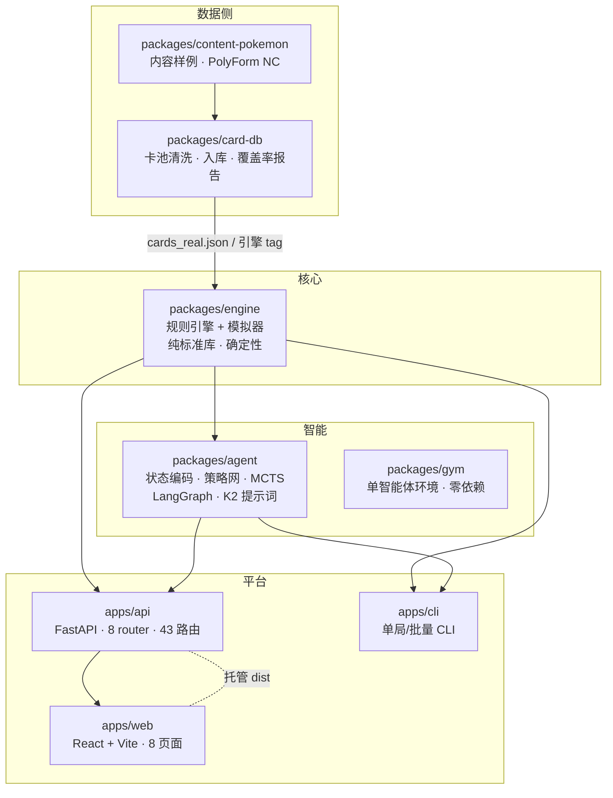
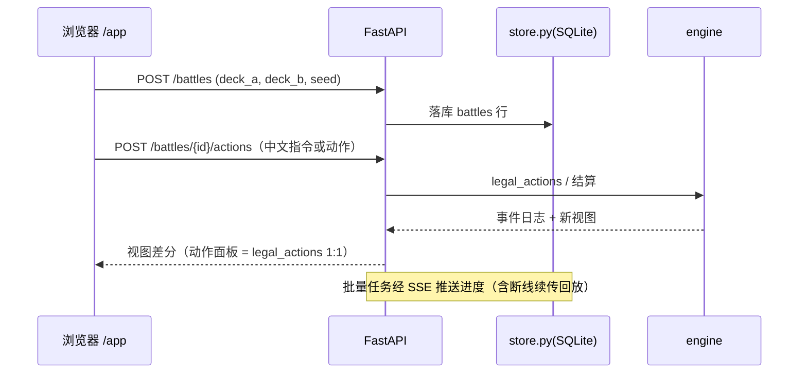
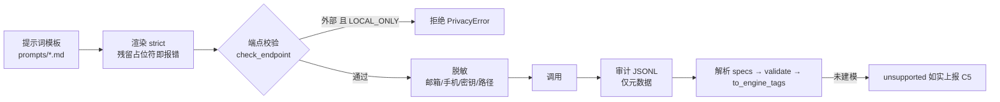

# PokéLab AI · 架构总览

> 本文是 monorepo 的**模块边界与运行时约定**总入口（`CONTRIBUTING.md` 引用）。
> 决策链根文档（可行性 → 立项 → MVP → 战略 → 技术方案）存于仓库外，见 `docs/README.md`。

## 1. 依赖图

**边界规则**（CI 与测试共同守护）：

| 规则 | 说明 |
|---|---|
| `engine` 零三方依赖 | 纯 Python 标准库，任意环境可跑；**确定性**：同 seed → 同事件序列 |
| `agent` 可依赖 `engine`，反向不可 | 引擎不感知 Agent/网络，只暴露 `legal_actions` / `view()` |
| 数据不进代码 | 卡池在 `packages/card-db/data/`（运行时导入）；`engine/data/cards_real.json` 为**策展子集**（引擎原生可跑的 40 张原型） |
| 前端只经 HTTP 访问后端 | 同源部署 `/app`；dev 由 Vite 代理 `/api` → `:8000` |
| 违规即失败 | `.github/workflows/ci.yml` 的 `redline` job 拦截数据红线与本地路径 |

## 2. 请求链路（平台）

## 3. 运行时数据与配置（**备份须知**）

### 3.1 数据目录优先级

`POKELAB_DATA_DIR` → `~/.pokelab` → `<系统临时目录>/pokelab` → `apps/api/data`
（首个**可写者**胜出；受限环境自动回退，见 `apps/api/app/store.py::_pick_data_dir`）

> **常见误解**：仓库里的 `apps/api/data/api.db` 不是运行库 —— 正常环境下运行库在
> `~/.pokelab/api.db`。仓库内该目录被 `.gitignore` 忽略。

### 3.2 `~/.pokelab/` 内容与重要性

| 文件 | 作用 | 丢失后果 |
|---|---|---|
| `api.db` | 运行库：`users` / `decks` / `battles` / `jobs` / `settings` | **数据全丢**（对战记录、卡组、任务、后台配置） |
| `.field_key` | `settings` 中加密字段（如 `llm.key`）的密钥 | **已存 LLM 密钥不可解密**（不可再生） |
| `.jwt_secret` | 登录 token 签名密钥 | 所有用户需重新登录 |
| `llm_audit.jsonl` | LLM 调用审计（合规 6.2，**不含原文**） | 合规审计链断裂 |
| `train_jobs/` | 训练任务产物与 K1 报告 | 训练结果丢失 |

**备份**：`python apps/api/scripts/backup_data.py`（见该脚本 `--help`）。
**禁用审计**：`POKELAB_AUDIT=0`（**不建议**，会失去合规审计链）。

### 3.3 关键环境变量

| 变量 | 作用 |
|---|---|
| `POKELAB_DATA_DIR` | 覆盖数据目录 |
| `POKELAB_LOCAL_ONLY=1` | **禁止外部 LLM 端点**（`check_endpoint` 拒绝外发） |
| `POKELAB_LLM_BASE` / `_KEY` / `_MODEL` / `_TIMEOUT` | LLM 端点注入（也可在后台「模型配置」页设置，加密存 `settings`） |
| `POKELAB_FIELD_ENC=1` | 启用敏感字段加密（依赖 `.field_key`） |
| `POKELAB_QWEN_MODEL` / `POKELAB_QWEN_QUANT` | 本地 Qwen 权重路径 / 量化档（8bit 默认；4bit 会削弱格式遵循，**不用于 K2**） |
| `POKELAB_AUDIT` | 审计开关（默认开） |

## 4. LLM 数据链路（合规 6.2）

要点：

- **枚举与取值域由代码/引擎注入**（`engine.battle.dmg_vocab()` + `render_system_prompt()`），
  **不要**在 `.md` 里手抄 —— 那是历史上枚举漂移的根因
- **模板渲染用 `strict=True`**：残留 `@@占位符@@` 会抛错（曾发生过「卡牌类别从未传给模型」的静默 bug）
- `POKELAB_LOCAL_ONLY=1` 下云端**不可用**：切云端 = 数据外发，此时被拒（保底的合规边界）

## 5. 测试与 CI

| 套件 | 命令（**须先 cd**） | 规模 |
|---|---|---|
| engine | `cd packages/engine && python -m unittest discover -s tests` | 213 |
| agent | `cd packages/agent && python -m unittest discover -s tests` | 148（需 torch） |
| api | `cd apps/api && python -m unittest discover -s tests` | 126 |
| 前端构建 | `cd apps/web && npm run build` | — |
| 端到端 | `apps/web/e2e/*.cjs`（需前后端已启动） | 13 个场景 |

CI（`.github/workflows/ci.yml`）：`engine` 单测 · `agent` 静态编译 · `carddb` 离线 demo ·
`api` 单测 · `web` 构建 · `redline` 红线守卫（数据文件 + 本地路径，**含文件内容扫描**）。

## 6. 决策记录（ADR）

| 编号 | 决策 | 状态 |
|---|---|---|
| ADR-LLM-001 | 解析/解说**优先本地**，K2 不达标才切云端保底 | 已确认；**保底已启用并验证**（云端 100%，见 `docs/COMPLIANCE.md`） |
| ADR-DB-001 | `decks` 归档语义 / `matches.batch_task_id` 反查 | 已确认（数据库设计 v1.1） |

> 说明：`packages/card-db/data/db/pokelab.db` 是**设计期 schema**（`batch_tasks` / `matches` /
> `model_registry` / `training_tasks` / `decks` / `users` 等表**已被 `api.db` 取代，现全空**），
> 现仅保留 `cards`（卡池，1267 行）与 `rule_chunks`（规则知识库，6 行）两张在用表。
